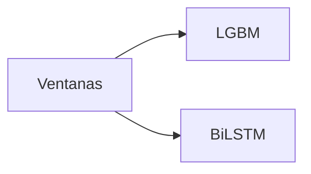

# Esquema — Bases LightGBM y BiLSTM

> Nota de repaso rápido. Teoría completa: [[00-bases-lgbm-bilstm]]

## La idea en una frase

> Tabla pesimista + película con memoria.

## Las N piezas

| Pieza | Qué es | Analogía |
|---|---|---|
| LGBM 0.35 | Percentil bajo | Presupuesto pesimista |
| BiLSTM | 2x64 + pooling x3 | Ver película + resumen |
| run_seed | Entrena una semilla | Una tirada de dados |

## El flujo (memorizar el orden)

## Sí / No (trampas frecuentes)

- ✅ 0.35 subestima a propósito.
- ❌ Más épocas no arreglan mala semilla.

## Flashcards #flashcards

- ¿Qué objetivo usa el LGBM? :: Cuantil 0.35.
- ¿Qué concatena el triple pooling? :: Último, media y máximo.

## Estado

- [ ] En curso
