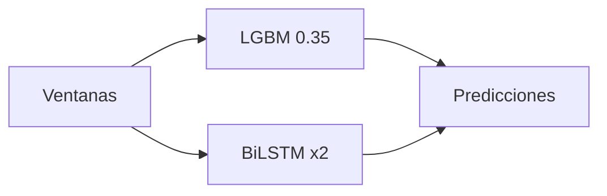

# Bases LightGBM y BiLSTM

## Idea central

Dos especialistas ven mejor que uno: tabla contra película.

> LightGBM lee estadísticas, BiLSTM lee la secuencia. Ninguno ve el futuro.

## ¿Qué problema resuelve?

Un resumen tabular pierde el orden; una secuencia pierde el agregado. Juntarlos da inercia + nivel.

## Las piezas del modelo mental

### LightGBM cuantil (`src/ds02_rul/pipeline.py:46`)

```python
def make_lgbm(seed: int) -> LGBMRegressor:
    return LGBMRegressor(**LGB_PARAMS, random_state=seed)
# LGB_PARAMS: objective='quantile', alpha=0.35
```

- Qué entra: `X_tab (ventana,93)`, 93 columnas.
- Qué sale: percentil 35 de RUL (tiende a subestimar a propósito).
- Por qué 0.35 y no mediana: la mediana gana en dev pero pierde en test (documentado en NB01 y ADR-007). Pasarse cuesta un motor; quedarse corto solo adelanta revisión.

### BiLSTM triple-pooling (`src/ds02_rul/model.py:19`)

```python
x = Bidirectional(LSTM(64, return_sequences=True))(inp)  # x2 capas + Dropout 0.2
pooled = Concatenate()([
    LastStepPooling()(x),        # estado actual
    GlobalAveragePooling1D()(x),  # nivel de la trayectoria
    GlobalMaxPooling1D()(x),      # transitorio extremo
])
out = Dense(1)(Dense(32, activation='relu')(pooled))
# compile: Adam 0.001, Huber(delta=10), 154253 params, input (None,50,19)
```

- Qué entra: `X_seq (ventana,50,19)`.
- Qué sale: RUL puntual.
- Por qué triple: último = ahora, media = nivel, máximo = pico. Early stopping en motor 16.

### Entrenar una semilla (`src/ds02_rul/pipeline.py:88`)

```python
def run_seed(raw, seed, fit_units, holdout_units, test_units,
             window=50, step_train=3, step_test=2, epochs=22, ...):
    prep = fit_preprocessing(W_tr[fit], Xs_tr[fit])  # solo fit
    lgbm = make_lgbm(seed).fit(dev X_tab[fit], dev y[fit])
    model, history = fit_bilstm(dev X_seq, dev y, fit_idx, hold_idx, seed)
```

- Qué entra: `raw` + listas de motores + semilla (42/7/123).
- Qué sale: `prep, lgbm, bilstm, dev/test, p_lgb/p_lstm, history`.
- En notebook: NB01 celdas 15 (LGBM 0.27s, RMSE 7.113) y 20 (BiLSTM ~65s, RMSE 5.839).

## El proceso completo, sin centrarnos en las cuentas



## Qué no debemos confundir

| Concepto | Qué significa | Qué no significa |
|---|---|---|
| alpha 0.35 | Percentil 35, subestima | Error de calibración |
| Triple pooling | Último+media+máximo | 3 modelos distintos |

## Conexión con los notebooks del repositorio

- NB01 celdas 15/17/20: LGBM, baseline media, BiLSTM semilla 42.

## Resumen para recordar

> Tabla pesimista + película con memoria.

## Autoevaluación

1. ¿Por qué 0.35 y no 0.5?
2. ¿Qué aporta cada pooling?
3. ¿Qué valida el motor 16?
