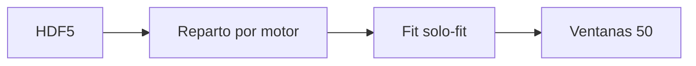

# Datos, prepro y ventanas

## Idea central

Todo se juega antes de entrenar: repartir por motor, limpiar el régimen, cortar ventanas.

> Si el reparto está mal, todo lo demás miente aunque el código sea perfecto.

## ¿Qué problema resuelve?

Un motor no es una fila suelta: son miles de lecturas encadenadas. Si mezclas ventanas del mismo motor en train y val, el modelo copia en vez de aprender. Este nodo deja el suelo honesto.

## Las piezas del modelo mental

### Reparto por motor (`src/ds02_rul/data.py:49`)

```python
def load_ds02(path: str | None = None, stride: int = 100) -> dict:
    resolved = resolve_ds02(path)
    with h5py.File(resolved, "r") as fh:
        data = {k: fh[k][::stride] for k in DEV_KEYS + TEST_KEYS}
```

- Qué entra: el HDF5 `N-CMAPSS_DS02-006.h5`.
- Qué sale: dict con `A/W/Xs/y` de dev y test, muestreados 1 de cada 100.
- Por qué así: el stride 100 hace el problema computable; no hay recorte a 125 (ese es solo de FD001).

En el notebook: NB01 celdas 9 (reparto fit `[2,5,10,18,20]` + holdout `16` + test `[11,14,15]`, dev 17450 ventanas, test 6196).

### Prepro solo-fit (`src/ds02_rul/features.py:25`)

```python
def fit_preprocessing(W_raw, Xs_raw) -> dict:
    X_full = np.hstack([W_raw, Xs_raw])
    scaler = StandardScaler().fit(X_full)   # solo motores de ajuste
    poly = PolynomialFeatures(degree=2).fit(W_scaled)
    ridge = Ridge(alpha=1.0).fit(P, Xs_raw[:, j])  # un Ridge por sensor
    res[:, j] = Xs_raw[:, j] - ridge.predict(P)
```

- Qué entra: régimen `W` (alt, Mach, TRA, T2) y sensores `Xs` de los fit-units.
- Qué sale: `scaler, poly, ridges, res_scaler, residualizer`.
- Por qué así: el Ridge aprende cuánto del sensor explica el vuelo y lo resta. Se ajusta solo con fit-units: si entrara el holdout o el test, habría fuga.

### Ventanas (`src/ds02_rul/features.py:79`)

```python
def build_windows(W_raw, Xs_raw, y, units, cycles, prep,
                  window_size: int = 50, step: int = 1, ...) -> dict:
    # ...
    # y_list.append(float(y_u[i + window_size - 1]))
```

- Qué entra: series + `prep` + `window=50, step 3 train / 2 test`.
- Qué sale: `X_seq (ventana,50,19)`, `X_tab (ventana,93)`, `y` = RUL de la **última** fila.
- Por qué así: 19 = 18 escalados + `cyc_norm`; la etiqueta es la última fila porque la ventana “termina” ahí.

## El proceso completo, sin centrarnos en las cuentas



## Qué no debemos confundir

| Concepto | Qué significa | Qué no significa |
|---|---|---|
| Stride 100 | 1 de cada 100 filas originales | 100 ciclos por ventana |
| Step 3/2 | Separación entre ventanas | Tamaño de ventana |
| Residuo | Sensor menos vuelo explicado | Sensor filtrado sin más |

## Conexión con el aprendizaje

Sin este suelo (N1-N2 del vault), OOF y beta no tienen sentido.

## Conexión con los notebooks del repositorio

- `notebooks/ds02_ensemble/01_datos_y_bases.ipynb`, celdas 9 (reparto), 11 (prepro), 13 (ventanas).

## Resumen para recordar

> Reparto primero, Ridge solo-fit, ventana 50 con etiqueta final.

## Autoevaluación

1. ¿Por qué el scaler no puede ver el holdout?
2. ¿Por qué la etiqueta es la última fila?
3. ¿Qué cambia entre step 3 y step 2?
