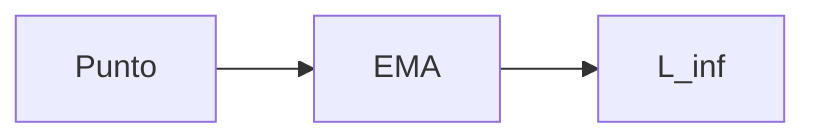

# Esquema — EMA, conformal y métricas

> Nota de repaso rápido. Teoría completa: [[00-ema-conformal-metricas]]

## La idea en una frase

> Suaviza causal, decide por L_inf, mide por motor.

## Las N piezas

| Pieza | Qué es | Analogía |
|---|---|---|
| EMA 5 | Media causal por motor | Amortiguador |
| L_inf | Peor caso 90% | Cinturón |
| Macro | 1/3 por motor | Voz por motor |

## El flujo (memorizar el orden)

## Sí / No (trampas frecuentes)

- ✅ EMA no mira el futuro.
- ❌ 100% cobertura no es mejor banda (es ancha).

## Flashcards #flashcards

- ¿Qué span usa la EMA? :: 5.
- ¿Qué es L_inf? :: Límite inferior de la banda.

## Estado

- [ ] En curso
