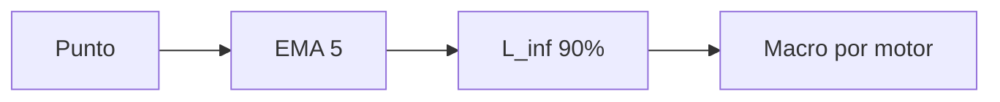

# EMA, conformal y metricas

## Idea central

Suavizar la alarma, decidir por el peor caso, medir por motor.

> El punto dice cuándo; la banda dice con qué margen te puedes equivocar.

## ¿Qué problema resuelve?

Ventana a ventana la predicción parpadea; el RMSE global esconde al motor 14; el punto no dice riesgo. EMA + banda + macro lo arreglan.

## Las piezas del modelo mental

### EMA causal (`src/ds02_rul/smoothing.py:14`)

```python
def causal_ema_by_unit(pred, units, cycles, span=5):
    for unit in unique(units):
        idx = idx[argsort(cycles[idx])]
        out[idx] = Series(pred[idx]).ewm(span=span, adjust=False).mean()
```

- Qué entra: predicción + motor + ciclo.
- Qué sale: predicción suavizada sin mirar el futuro (`adjust=False`, por motor).
- Por qué 5: evita que la alarma parpadee; lo usa `p = p_lstm + beta*(p_meta-p_lstm)` antes de medir.

### Banda split-conformal (`src/ds02_rul/conformal.py:28`)

```python
def fit_conformal(y_true, pred, target=0.90, edges=[0,25,50,75,inf]):
    resid = y_true - pred
    lo, hi = quantile(resid_bin, [0.05, 0.95])  # asimétrico por bin
def apply_conformal(pred, calib):
    lower = pred + q_low; upper = pred + q_high
    # lower<=pred<=upper, lower recortado a 0 si pred>=0
```

- Qué entra: residuos OOF de 6 motores (17450 filas).
- Qué sale: `q_low/q_high` por tramo + `(L_inf, upper)`.
- Por qué asimétrica: la NASA tampoco es simétrica; calibrar en motor 16 se rechaza (sin vida alta, residuales de ajuste). Cobertura test 100% = sobre-cubre, se publica el trade-off.

### Métricas (`src/ds02_rul/metrics.py:21`)

```python
def calculate_nasa_score(y_true, y_pred):
    d = y_pred - y_true
    score = where(d<0, exp(-d/13)-1, exp(d/10)-1)  # pasarse cuesta más
def macro_rmse(y_true, y_pred, units):
    # media de RMSE por motor, cada motor pesa 1/3
def evaluate_predictions(y_true, y_pred, model_name):
    # RMSE / MAE / R2 / NASA
```

- En notebook: NB02 19 (híbrido 4.276), 23 (por motor 11/14/15), 25-26 (banda); NB03 8/18 (multisemilla).

## El proceso completo, sin centrarnos en las cuentas



## Qué no debemos confundir

| Concepto | Qué significa | Qué no significa |
|---|---|---|
| EMA | Quitar parpadeo causal | Mirar el futuro |
| 90% nominal | Objetivo | Garantía en 3 motores |
| Macro | Cada motor 1/3 | Media ponderada |

## Conexión con los notebooks del repositorio

- NB02 23/25/26 + NB03 40/43: por motor, banda, cobertura.

## Resumen para recordar

> Suaviza causal, decide por L_inf, mide por motor.

## Autoevaluación

1. ¿Por qué EMA causal y no media simple?
2. ¿Por qué la banda es asimétrica?
3. ¿Por qué macro además de global?
