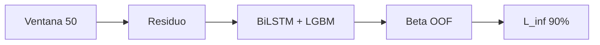

# Esquema — Guion 30 segundos

> Nota de repaso rápido. Teoría completa: [[00-guion-30-segundos]]

## La idea en una frase

> Ventana, residuo, dos bases, beta honesta, peor caso.

## Las N piezas

| Pieza | Qué es | Analogía |
|---|---|---|
| Ventana | 50 lecturas → RUL | Foto de 50 fotogramas |
| Residuo | Quitar efecto vuelo | Quitar fiebre del termómetro |
| Bases | BiLSTM + LGBM | Película + tabla |
| Beta | Cuánto manda el meta | Fader de mezcla |
| L_inf | Peor caso 90% | Cinturón antes de frenar |

## El flujo (memorizar el orden)

## Sí / No (trampas frecuentes)

- ✅ El guion es el orden para contar, no la demostración.
- ❌ No hay que recitar código de memoria en el guion.

## Flashcards #flashcards

- ¿Cuáles son las 5 paradas? :: Ventana, residuo, dos bases, beta honesta, peor caso.
- ¿Sobre qué decidimos? :: Sobre L_inf, el límite inferior al 90%.

## Estado

- [ ] En curso
