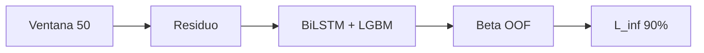

# Guion 30 segundos

## Idea central

Predecimos cuántos ciclos le quedan a un motor y decidimos sobre el peor caso.

> Ventana de 50 lecturas → RUL. Si dudamos, miramos el límite inferior.

## ¿Qué problema resuelve?

El tribunal no quiere 19 nodos en 30 segundos. Quiere una frase para colgar todo lo demás. Este guion es esa frase.

## Las piezas del modelo mental

### La frase

> Predecimos la vida restante por ventanas, quitamos el efecto del vuelo, combinamos dos modelos con beta honesta y decidimos sobre el peor caso de la banda al 90%.

### Las 5 paradas

1. Ventana de 50 → un número (N1).
2. Residualizar: quitar el calor del régimen, quedarse el desgaste (N5).
3. Dos bases: BiLSTM ve la película, LightGBM ve la tabla (N7-N8).
4. Beta OOF: combinar sin mirarse al espejo (N11-N12).
5. Decidir por `L_inf`: el peor caso defendible (N14).

## El proceso completo, sin centrarnos en las cuentas

## Qué no debemos confundir

| Concepto | Qué significa | Qué no significa |
|---|---|---|
| Guion | Orden para contar | Demostración técnica |
| 30 segundos | La idea colgadero | El detalle de cada celda |

## Conexión con el aprendizaje

Es el mapa del mapa: si te pierdes en una celda gigante, vuelve a estas 5 paradas.

## Conexión con los notebooks del repositorio

- `notebooks/ds02_ensemble/01_datos_y_bases.ipynb` → paradas 1-3.
- `notebooks/ds02_ensemble/02_decision_ablacion_oof_ensamble.ipynb` → paradas 4-5.
- `notebooks/ds02_ensemble/03_evidencia_multisemilla_diagnostico.ipynb` → prueba de que el hilo aguanta 3 semillas.

## Resumen para recordar

> Ventana, residuo, dos bases, beta honesta, peor caso.

## Autoevaluación

1. ¿Cuáles son las 5 paradas en orden?
2. ¿Qué significa decidir por el peor caso?
3. ¿Qué notebook cubre cada parada?
