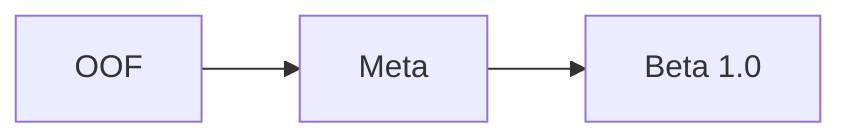

# Esquema — OOF, beta y stacking

> Nota de repaso rápido. Teoría completa: [[00-oof-beta-stacking]]

## La idea en una frase

> Otro motor puntúa, mediana decide.

## Las N piezas

| Pieza | Qué es | Analogía |
|---|---|---|
| OOF | Otro motor evalúa | Examen externo |
| Meta 16 | Ridge+LGBM en holdout | Jurado del motor 16 |
| Beta | Fader 0-1 | Volumen del meta |

## El flujo (memorizar el orden)

## Sí / No (trampas frecuentes)

- ✅ Cada fold reajusta su prepro.
- ❌ Elegir beta in-sample miente (0.308).

## Flashcards #flashcards

- ¿Qué folds se usan? :: [2,10],[5,18],[20,16].
- ¿Qué beta sale? :: 1.0 (mediana).

## Estado

- [ ] En curso
