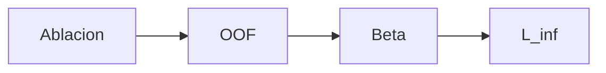

# Esquema — Anexo NB02

> Nota de repaso rápido. Teoría completa: [[02-anexo-nb02-celdas]]

## La idea en una frase

> Medir, combinar honesto, decidir por peor caso.

## Las N piezas

| Pieza | Qué es | Analogía |
|---|---|---|
| Ablación | Quitar ciclo y medir | Quitar muleta |
| OOF+beta | Otro motor elige | Jurado externo |
| Banda | L_inf 90% | Red de seguridad |

## El flujo (memorizar el orden)

## Sí / No (trampas frecuentes)

- ✅ Tabla titular decide, extra curiosea.
- ❌ Test no elige, solo comprueba.

## Flashcards #flashcards

- ¿Qué beta sale? :: 1.0.
- ¿Qué motor carga el error? :: El 14.

## Estado

- [ ] En curso
