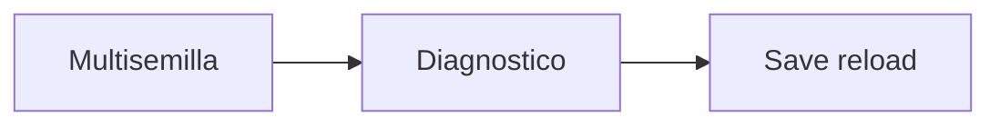

# Esquema — Anexo NB03

> Nota de repaso rápido. Teoría completa: [[03-anexo-nb03-celdas]]

## La idea en una frase

> Estable, mejor donde decide, guardado que recarga.

## Las N piezas

| Pieza | Qué es | Analogía |
|---|---|---|
| Multisemilla | 42/7/123 | 3 dados |
| Diagnóstico | Dónde falla | Autopsia |
| Save/reload | models/ + check | Caja fuerte + llave |

## El flujo (memorizar el orden)

## Sí / No (trampas frecuentes)

- ✅ Estabilidad ≠ acierto (LGBM estable pero peor).
- ❌ No re-ejecutar antes de defensa.

## Flashcards #flashcards

- ¿Qué motor falla más? :: El 14.
- ¿Qué prueba RELOAD OK? :: Recargado == memoria.

## Estado

- [ ] En curso
