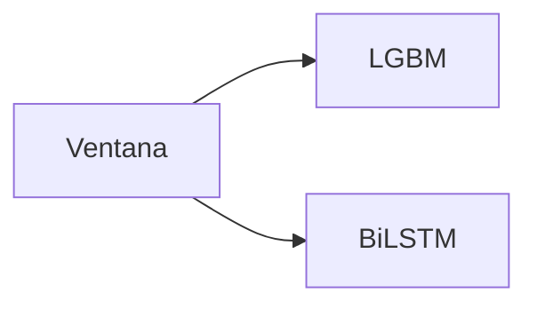

# Esquema Bases (B)

> Nota de repaso rapido. Teoria completa: [[00-bases-lgbm-bilstm]]

## La idea en una frase

> Tabla + pelicula sobre la misma ventana.

## Las 2 piezas

| Pieza | Que es | Analogia |
|---|---|---|
| LGBM | Lee 93 columnas | Foto fija |
| BiLSTM | Lee 50x19 secuencia | Pelicula |

## El flujo

## Si / No

- SI: evaluar_clase no entrena.
- NO: viz.py no cambia metricas.

## Flashcards #flashcards

- LGBM determinista? :: Si, 7.098 clavado.
- Triple pooling? :: last + avg + max.

## Estado

- [ ] En curso
