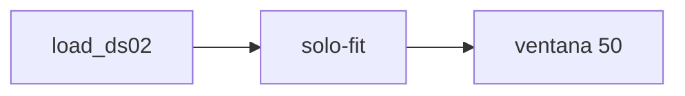

# Esquema Datos prepro y ventanas (B)

> Nota de repaso rapido. Teoria completa: [[00-datos-prepro-ventanas]]

## La idea en una frase

> Reparto por motor + solo-fit + ventana 50.

## Las 3 piezas

| Pieza | Que es | Analogia |
|---|---|---|
| Reparto | Motores separados | Examen con temas no vistos |
| Solo-fit | Scaler+ridges en ajuste | Calibrar sin ver el examen |
| Ventana | 50 ciclos hacia 1 RUL | Ventana del tren |

## El flujo

## Si / No

- SI: Step 3 train / 2 test, etiqueta final.
- NO: El scaler no se reajusta en test.

## Flashcards #flashcards

- Forma dev tras ventanas? :: (17450,50,19) + y (17450,93).
- Que motores son test? :: 11, 14 y 15.

## Estado

- [ ] En curso
