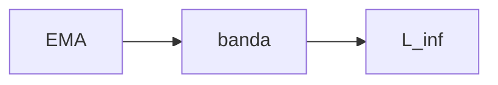

# Esquema EMA conformal y metricas (B)

> Nota de repaso rapido. Teoria completa: [[00-ema-conformal-metricas]]

## La idea en una frase

> Suavizar causal + banda 90% + decidir abajo.

## Las 3 piezas

| Pieza | Que es | Analogia |
|---|---|---|
| EMA | Suavizado solo pasado | Media movil sin trampa |
| Banda | Intervalo 90% asimetrico | Horquilla honesta |
| Macro | Media por motor | Nota por alumno, no por examen |

## El flujo

## Si / No

- SI: NASA suma, no media.
- NO: Macro no es el RMSE ponderado.

## Flashcards #flashcards

- Cifras B ref? :: RMSE 4.251, R2 0.9482, NASA 2305.1.
- Macro B? :: 4.8433 (motor 14: 7.997).

## Estado

- [ ] En curso
