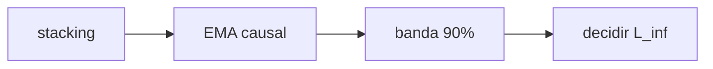

# EMA conformal y metricas (B)

> Version B (refactor novato-friendly): src/ds02_rul/viz.py + from ds02_rul.viz import * en 1 linea, glosario WINDOW/STEP/BETA/EMA5/L_inf/OOF/macro y Que entra/sale por celda. Logica identica al bundle A; cifras bundle B: ref RMSE 4.251, R2 0.9482, NASA 2305.1, macro 4.8433, LGBM 7.098, hashes ensemble 7acba335 / bilstm d0c5ed7f.

## Idea central

Suavizar sin mirar el futuro (EMA causal) y decidir sobre el peor caso (banda conformal 90%), midiendo con RMSE/MAE/R2/NASA + macro.

## Las piezas

### EMA causal (smoothing.py)

Media por motor solo con pasado. Quita diente de sierra sin fuga.

### Banda conformal asimetrica (conformal.py)

fit_conformal calibra por bins, apply_conformal da (lower, upper). Se decide por L_inf: el peor caso defendible.

### Metricas (metrics.py)

Bundle B: ref RMSE 4.251, MAE 3.183, R2 0.9482, NASA 2305.1; macro 4.8433 (motor 14: 7.997, el que mas duele); media 3 semillas hibrido 4.340+-0.101 ganando a BiLSTM 6.218+-0.541.

## El proceso

## Que no confundir

| Concepto | Que significa | Que no significa |
|---|---|---|
| L_inf | Limite inferior | Prediccion puntual |
| Macro | Media de RMSE por motor | RMSE ponderado |
| NASA | Suma asimetrica (castiga tarde) | Media |

## Conexion notebooks

- NB02/NB03 + src-smoothing/conformal/metrics.codigo.md.

## Resumen

> Suavizar causal + banda 90% + decidir abajo + macro.

## Autoevaluacion

1. Por que causal la EMA?
2. Por que decidir por L_inf?
3. Por que macro ademas de ref?
