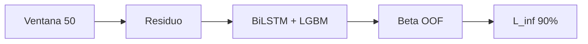

# Esquema Guion 30 segundos (B)

> Nota de repaso rapido. Teoria completa: [[00-guion-30-segundos]]

## La idea en una frase

> Ventana, residuo, dos bases, beta honesta, peor caso.

## Las 5 piezas

| Pieza | Que es | Analogia |
|---|---|---|
| Ventana 50 | 50 ciclos hacia 1 RUL | Foto de 50 fotogramas |
| Residuo | Quitar regimen | Quitar el ruido del avion |
| Bases | BiLSTM + LGBM | Pelicula + tabla |
| Beta OOF | Peso honesto | Juez que no se vota a si mismo |
| L_inf | Peor caso 90% | Cinturon de seguridad |

## El flujo

## Si / No

- SI: B = misma logica, celdas pequenas + viz.py.
- NO: B no es otro modelo ni otras metricas estructurales.

## Flashcards #flashcards

- 5 paradas en orden? :: Ventana, residuo, dos bases, beta honesta, peor caso.
- Que aporta viz.py? :: Los 12 helpers de graficos/tablas salen de la celda gigante a src/ds02_rul/viz.py.

## Estado

- [ ] En curso
