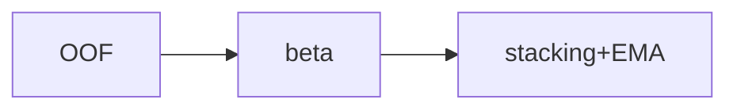

# Esquema OOF beta y stacking (B)

> Nota de repaso rapido. Teoria completa: [[00-oof-beta-stacking]]

## La idea en una frase

> OOF honesto hacia beta mediana hacia stacking + EMA.

## Las 3 piezas

| Pieza | Que es | Analogia |
|---|---|---|
| OOF | Predecir sin verse | Examen ciego |
| Beta | Peso mediano | Mediana de jueces |
| Stacking | Combinar + suavizar | Mezcla + alisado |

## El flujo

## Si / No

- SI: OOF agrupado por motor.
- NO: La beta no se ajusta en test.

## Flashcards #flashcards

- Por que mediana? :: Robusta al motor raro (14).
- EMA causal? :: Solo pasado, sin futuro.

## Estado

- [ ] En curso
