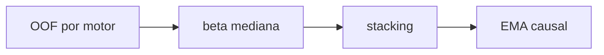

# OOF beta y stacking (B)

> Version B (refactor novato-friendly): src/ds02_rul/viz.py + from ds02_rul.viz import * en 1 linea, glosario WINDOW/STEP/BETA/EMA5/L_inf/OOF/macro y Que entra/sale por celda. Logica identica al bundle A; cifras bundle B: ref RMSE 4.251, R2 0.9482, NASA 2305.1, macro 4.8433, LGBM 7.098, hashes ensemble 7acba335 / bilstm d0c5ed7f.

## Idea central

Combinar sin mirarse al espejo: OOF agrupado por motor da la beta mediana honesta, el stacking la usa.

## Las piezas

### OOF agrupado por motor

3 folds por motor: cada motor se predice con un modelo que nunca lo vio. Sin esto, la beta se autoengana.

### Beta mediana

Mediana de las betas por fold. Estable frente a un motor raro (el 14 duele: 7.997 en B).

### Stacking hibrido (stacking.py, ensemble.py)

BiLSTM + LGBM + meta + EMA causal. Hibrido ref B 4.251 vs BiLSTM aprox 5.84 y LGBM 7.098.

## El proceso

## Que no confundir

| Concepto | Que significa | Que no significa |
|---|---|---|
| OOF | Prediccion honesta | Otra metrica mas |
| Beta | Peso mediano | Media simple |

## Conexion notebooks

- NB02 + src-stacking.codigo.md, src-ensemble.codigo.md, src-smoothing.codigo.md.

## Resumen

> OOF honesto hacia beta mediana hacia stacking + EMA.

## Autoevaluacion

1. Por que agrupado por motor?
2. Por que mediana y no media?
3. Que aporta la EMA causal?
