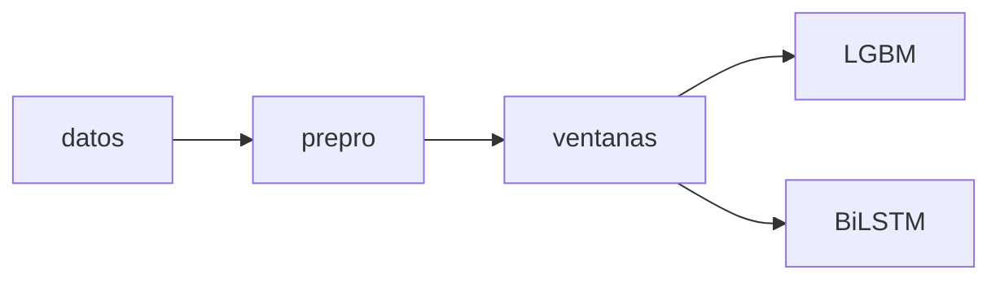

# Esquema Anexo NB01 (B)

> Nota de repaso rapido. Teoria completa: [[01-anexo-nb01-celdas]]

## La idea en una frase

> Suelo honesto + 2 bases 42 + puente.

## Orden a memorizar

## Si / No

- SI: viz.py solo dibuja.
- NO: NB01 no decide beta.

## Flashcards #flashcards

- Import estilo clase? :: from ds02_rul.viz import *.
- LGBM NB01? :: RMSE 7.098.

## Estado

- [ ] En curso
