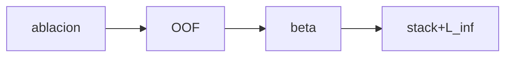

# Esquema Anexo NB02 (B)

> Nota de repaso rapido. Teoria completa: [[02-anexo-nb02-celdas]]

## La idea en una frase

> OOF honesto hacia beta mediana hacia stacking + L_inf.

## Orden a memorizar

## Si / No

- SI: Beta mediana, no media.
- NO: No se decide por la puntual.

## Flashcards #flashcards

- Decision? :: L_inf de la banda 90%.
- Macro B? :: 4.8433.

## Estado

- [ ] En curso
