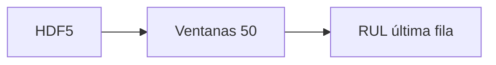

# Esquema — Qué predecimos (RUL por ventanas)

> Nota de repaso rápido. Teoría completa: [[01-que-predecimos-rul]]

## La idea en una frase

> Ventana de 50 lecturas → un número: ciclos de vida restante.

## Las N piezas

| Pieza | Qué es | Analogía |
|---|---|---|
| Ventana | 50 filas seguidas de un motor | Foto de 50 fotogramas |
| RUL | Ciclos que le quedan al último ciclo | Kilómetros restantes del depósito |
| Step | Separación entre ventanas (3 train / 2 test) | Paso al cortar lonchas |

## El flujo (memorizar el orden)

## Sí / No (trampas frecuentes)

- ✅ El objetivo es el RUL del último ciclo de la ventana.
- ❌ La ventana son 50 ciclos de vuelo reales (hay stride 100 de por medio).

## Flashcards #flashcards

- ¿Qué devuelve el modelo por cada ventana? :: Un número: el RUL en ciclos.
- ¿Cuántas filas tiene cada ventana? :: 50.

## Estado

- [ ] En curso
