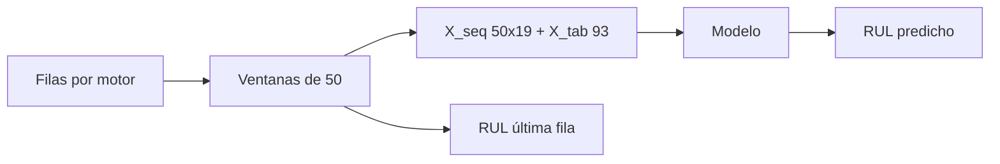

# Qué predecimos (RUL por ventanas)

## Idea central

Todo RUL se predice por ventanas de 50 lecturas consecutivas de sensores.

> Todo lo que el modelo ve es una ventana de 50 filas; todo lo que devuelve es un número: ciclos de vida restante.

## ¿Qué problema resuelve?

Un motor turbofán se degrada vuelo a vuelo. Queremos saber, en cada ciclo, cuántos ciclos le quedan (RUL = Remaining Useful Life) para planificar mantenimiento. El dataset N-CMAPSS DS02 (`archive/CCMaps/N-CMAPSS_DS02-006.h5`) trae 6 motores de desarrollo y 3 de test con 4 canales operativos W (alt, Mach, TRA, T2) y 14 sensores Xs.

## Las piezas del modelo mental

### Ventana

50 filas consecutivas de un mismo motor (`window_size=50` en `src/ds02_rul/pipeline.py:run_seed`). Con `stride=100` en la carga (`src/ds02_rul/data.py:load_ds02`), cada fila del HDF5 ya es 1 de cada 100 originales.

### Objetivo de la ventana

El RUL de su **última** fila: `y_list.append(float(y_u[i + window_size - 1]))` (`src/ds02_rul/features.py:build_windows`). La ventana "termina" en ese ciclo y hereda su etiqueta.

### Paso (step)

Cada cuántas filas se corta una ventana nueva: `STEP_TRAIN=3` en ajuste, `STEP_TEST=2` en test. Más paso = menos ventanas = menos cómputo.

## El proceso completo, sin centrarnos en las cuentas

## Qué no debemos confundir

| Concepto | Qué significa | Qué no significa |
|---|---|---|
| Ventana | 50 filas consecutivas muestreadas con stride 100 | 50 ciclos de vuelo reales |
| RUL | Ciclos restantes desde el último ciclo de la ventana | Vida total del motor |
| Step | Separación entre ventanas | Tamaño de la ventana |

## Conexión con el aprendizaje

Es la verdad incondicional del proyecto: todo lo demás (prepro, modelos, bandas) opera sobre ventanas. Sin esto firme, nada de lo que sigue tiene sentido.

## Conexión con los notebooks del repositorio

- `notebooks/ds02_ensemble/01_datos_y_bases.ipynb`, celdas 9 (reparto) y 13 (ventanas: dev 17.450 ventanas, test 6.196).

## Resumen para recordar

> Ventana de 50 → un número: el RUL de su último ciclo.

## Autoevaluación

1. ¿Por qué el objetivo es el RUL de la última fila y no el de la primera?
2. ¿Qué cambia entre STEP_TRAIN=3 y STEP_TEST=2?
3. ¿Cuántos canales tiene X_seq y por qué 19 y no 18?
