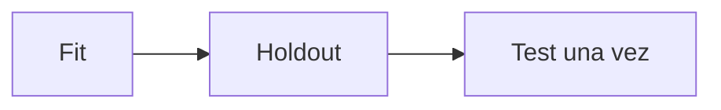

# Esquema — Reparto por motor y fuga

> Nota de repaso rápido. Teoría completa: [[02-reparto-por-motor-y-fuga]]

## La idea en una frase

> Por motor, no por filas: lo que ajusta no examina.

## Las N piezas

| Pieza | Qué es | Analogía |
|---|---|---|
| Fit 2 5 10 18 20 | Ajusta todo | Estudiar con unos exámenes |
| Holdout 16 | Valida y elige | Examen de prueba |
| Test 11 14 15 | Se toca una vez | Examen final |
| Fuga | Test filtrado al ajuste | Copiar en el examen |

## El flujo (memorizar el orden)

## Sí / No (trampas frecuentes)

- ✅ Holdout y test son motores enteros disjuntos.
- ❌ Repartir ventanas al azar es válido (es fuga).

## Flashcards #flashcards

- ¿Qué motores son test? :: 11, 14 y 15.
- ¿Cuántas veces se toca el test? :: Una sola vez.

## Estado

- [ ] En curso
