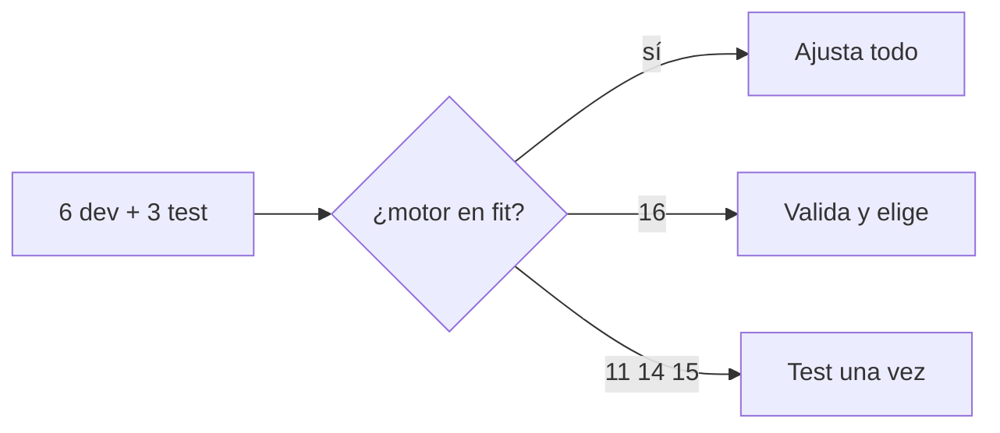

# Reparto por motor y fuga de información

## Idea central

Ninguna ventana de un motor aparece a la vez en ajuste y en test.

> El reparto se hace por motor entero, nunca por filas sueltas: quien aprende con el motor 11 no puede examinarse con el motor 11.

## ¿Qué problema resuelve?

Ventanas del mismo motor se parecen entre sí (misma degradación, mismo régimen). Repartir filas al azar —como el `train_test_split` de clase— filtraría el futuro al entrenamiento y los números mentirían. Aquí: ajuste `[2, 5, 10, 18, 20]`, holdout `16`, test `[11, 14, 15]`, con `assert` de no-intersección (`01_datos_y_bases.ipynb`, celda 9).

## Las piezas del modelo mental

### Fit / holdout / test

- **Fit (5 motores, 44.982 filas):** ajusta TODO (scalers, modelos).
- **Holdout motor 16 (7.653 filas):** valida y elige (early stopping, meta).
- **Test 11/14/15 (12.538 filas → 6.196 ventanas):** se toca una sola vez, al final.

### Fuga

Usar en ajuste cualquier estadística del holdout o del test. La revisión del proyecto la eliminó: `fit_preprocessing` solo ve fit-motores e imprime "el motor de holdout aportó 0 filas".

## El proceso completo, sin centrarnos en las cuentas

## Qué no debemos confundir

| Concepto | Qué significa | Qué no significa |
|---|---|---|
| Honesto | Motores disjuntos entre ajuste y test | Reparto aleatorio de filas |
| Holdout 16 | Motor de validación, decide early stopping y meta | Segundo test |
| Fuga | Estadística del holdout/test usada en ajuste | Solo "ver" los datos |

## Conexión con el aprendizaje

Es la raíz de la que cuelga la credibilidad de cada número del proyecto. Sin ella, el RMSE 4.275 no valdría nada.

## Conexión con los notebooks del repositorio

- `01_datos_y_bases.ipynb`, celda 9 (`FIT_UNITS`, `HOLDOUT_UNITS`, `TEST_UNITS`, asserts).
- `src/ds02_rul/data.py:load_ds02` (carga con stride, sin clamp de 125).

## Resumen para recordar

> Por motor, no por filas: lo que ajusta no examina.

## Autoevaluación

1. ¿Por qué `train_test_split` aleatorio sería fuga aquí?
2. ¿Qué decide el holdout y qué decide el test?
3. ¿Cómo demuestra el notebook que el holdout aportó 0 filas al prepro?
