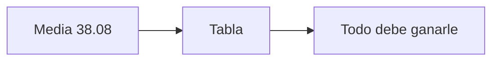

# Esquema — Baseline de media train

> Nota de repaso rápido. Teoría completa: [[03-baseline-media-train]]

## La idea en una frase

> 38.08 siempre: si no ganas al tonto, no hay modelo.

## Las N piezas

| Pieza | Qué es | Analogía |
|---|---|---|
| Media fit | 38.08 ciclos, solo ajuste | Apostar siempre al caballo medio |
| RMSE 20.022 | Suelo de la tabla | El listón por el suelo |
| evaluar_clase | Pone nota sin entrenar | El juez, no el jugador |

## El flujo (memorizar el orden)

## Sí / No (trampas frecuentes)

- ✅ El baseline encabeza la tabla pero no compite.
- ❌ R² negativo es un bug (es lo esperado en el tonto).

## Flashcards #flashcards

- ¿Baseline y su RMSE? :: Media train 38.08, RMSE 20.022.
- ¿Qué hace evaluar_clase? :: Pone nota sin entrenar.

## Estado

- [ ] En curso
