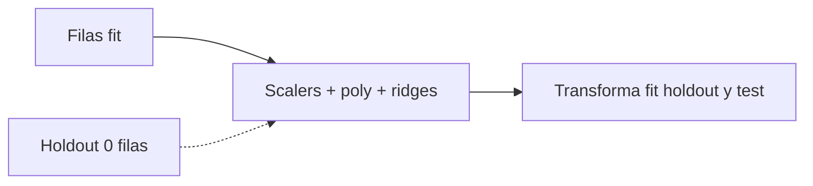

# Prepro ajustada solo en fit-motores

## Idea central

Todo lo que aprende estadísticas (scalers, base polinómica, ridges) se ajusta SOLO con los 5 motores de fit.

> El holdout aportó 0 filas a todos los objetos de arriba: ni siquiera a la media del scaler.

## ¿Qué problema resuelve?

Un scaler ajustado con todos los motores "conoce" el rango del holdout y del test. Esa es fuga silenciosa: no está en los pesos del modelo, pero contamina igual. Aquí `fit_preprocessing(W_tr[fit_row_mask], Xs_tr[fit_row_mask])` (`src/ds02_rul/features.py:fit_preprocessing`).

## Las piezas del modelo mental

### scaler y scaler_w

`StandardScaler` sobre los 18 canales juntos y sobre W por separado. Se imprimen `n_samples_seen` (44.982) y la media para auditar.

### Poly grado 2

`PolynomialFeatures(degree=2, include_bias=False)` sobre W escalado: la base para explicar cada sensor por el régimen.

### 14 ridges + res_scaler

Un `Ridge(alpha=1.0)` por sensor y un scaler de los residuos. El holdout no los ve jamás.

## El proceso completo, sin centrarnos en las cuentas

## Qué no debemos confundir

| Concepto | Qué significa | Qué no significa |
|---|---|---|
| Ajustar | Aprender medias/varianzas/pesos | Aplicar la transformación |
| Transformar | Puede aplicarse a cualquier fila | No contamina |

## Conexión con el aprendizaje

Es la prueba de fuego del protocolo honesto: la fuga no vive solo en el split, vive en el scaler.

## Conexión con los notebooks del repositorio

- `01_datos_y_bases.ipynb`, celda 11 (fit + verificación "0 filas").
- `src/ds02_rul/features.py:fit_preprocessing`.

## Resumen para recordar

> Ajusta con fit, transforma con todos; el holdout no enseña nada.

## Autoevaluación

1. ¿Por qué ajustar el scaler con todos sería fuga aunque el modelo no vea el test?
2. ¿Qué tres familias de objetos aprende `fit_preprocessing`?
3. ¿Cómo se verifica que el holdout aportó 0 filas?
