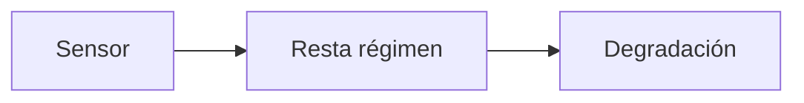

# Esquema — Sensor residualizado

> Nota de repaso rápido. Teoría completa: [[05-sensor-residualizado-regimen]]

## La idea en una frase

> Quita el régimen, quédate el desgaste.

## Las N piezas

| Pieza | Qué es | Analogía |
|---|---|---|
| W | 4 canales de régimen | El viento |
| Ridge x14 | Explica sensor por W | Descontar el viento |
| Residuo | Degradación pura | La señal del desgaste |

## El flujo (memorizar el orden)

## Sí / No (trampas frecuentes)

- ✅ El residuo es lo que el LightGBM debe ver.
- ❌ El régimen predice RUL (no, solo distrae).

## Flashcards #flashcards

- ¿Cuántos ridges y por qué? :: 14, uno por sensor.
- ¿Qué hace SensorResidualizer.transform? :: Resta el ridge y estandariza.

## Estado

- [ ] En curso
