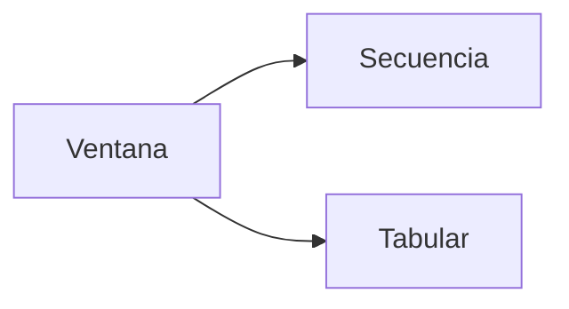

# Esquema — Ventanas y cyc_norm

> Nota de repaso rápido. Teoría completa: [[06-ventanas-y-cyc-norm]]

## La idea en una frase

> Una ventana, dos lecturas: película y ficha.

## Las N piezas

| Pieza | Qué es | Analogía |
|---|---|---|
| X_seq | 50×19 ordenados | La película |
| X_tab | 93 estadísticos | La ficha técnica |
| cyc_norm | Ciclo/100, atajo útil | El reloj de la película |

## El flujo (memorizar el orden)

## Sí / No (trampas frecuentes)

- ✅ Apagar cyc_norm mide cuánto depende el modelo del reloj.
- ❌ cyc_norm es fuga (es observable en producción).

## Flashcards #flashcards

- ¿Dimensiones de X_seq y X_tab? :: (50,19) y 93 columnas.
- ¿Qué etiqueta lleva cada ventana? :: El RUL de su último ciclo.

## Estado

- [ ] En curso
