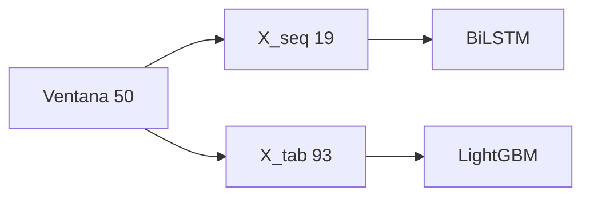

# Ventanas, X_tab y cyc_norm

## Idea central

Cada ventana produce dos vistas: la secuencia ordenada para el BiLSTM y un resumen tabular de 93 números para el LightGBM.

> Una ventana, dos lecturas: la película (secuencia) y la ficha (tabular).

## ¿Qué problema resuelve?

El BiLSTM necesita orden temporal; el LightGBM necesita columnas. `build_windows` (`src/ds02_rul/features.py:build_windows`) fabrica ambas de una vez, alineadas a la misma etiqueta.

## Las piezas del modelo mental

### X_seq (50, 19)

50 pasos × 18 señales escaladas + canal de ciclo normalizado (`c_u/100`). Ese canal 19 es `cyc_norm`: se puede apagar (`use_cycle=False`) y por eso existe la ablación.

### X_tab (93)

8 bloques tras el ciclo: media de W, último W, media de residuos, último residuo, std de residuos, media de las últimas 10, rango (último − primero) y deriva (media 2ª mitad − media 1ª mitad).

### cyc_norm: el atajo

El contador de ciclos casi determina el RUL porque las unidades fallan con vida parecida. Es entrada legítima en producción, pero también un atajo que enmascara si el modelo entiende degradación.

## El proceso completo, sin centrarnos en las cuentas

## Qué no debemos confundir

| Concepto | Qué significa | Qué no significa |
|---|---|---|
| cyc_norm | Canal ciclo/100, legítimo pero atajo | Fuga (es medible en producción) |
| Step 3 vs 2 | Densidad de ventanas train/test | Calidad distinta |

## Conexión con el aprendizaje

De aquí salen las dos ramas del ensamble y la pregunta de la ablación: ¿cuánto vale el reloj?

## Conexión con los notebooks del repositorio

- `01_datos_y_bases.ipynb`, celda 13 (dev 17.450×50×19, test 6.196, huella 66.3 MB).
- `src/ds02_rul/features.py:build_windows`, `use_cycle`.

## Resumen para recordar

> Secuencia para el que ve orden, tabla para el que ve columnas, reloj para los dos.

## Autoevaluación

1. ¿Por qué X_tab tiene 93 columnas con ciclo y 92 sin él?
2. ¿Qué es exactamente el canal 19?
3. ¿Por qué cyc_norm es atajo y a la vez entrada legítima?
