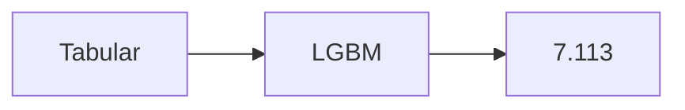

# Esquema — LightGBM cuantil

> Nota de repaso rápido. Teoría completa: [[07-lightgbm-cuantil]]

## La idea en una frase

> Cuantil prudente, barato y estable: el listón del BiLSTM.

## Las N piezas

| Pieza | Qué es | Analogía |
|---|---|---|
| Cuantil 0.35 | Predice por debajo de la mediana | Frenar antes de la curva |
| 300 árboles | Boosting frenado | Muchos consejeros cautos |
| 7.113 | RMSE que hay que batir | La marca a superar |

## El flujo (memorizar el orden)

## Sí / No (trampas frecuentes)

- ✅ El cuantil 0.35 se eligió contra la mediana con evidencia en test.
- ❌ Más árboles siempre es mejor (aquí van frenados y regularizados).

## Flashcards #flashcards

- ¿RMSE del LightGBM solo? :: 7.113.
- ¿Por qué no la mediana? :: Gana en dev pero pierde en test (motores más cortos).

## Estado

- [ ] En curso
