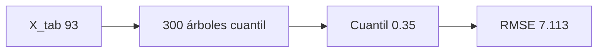

# LightGBM cuantil sobre tabular

## Idea central

Un gradient boosting sobre el resumen tabular que predice el cuantil 0.35 del RUL: rápido, estable y la referencia que el BiLSTM debe batir.

> 300 árboles en ~0.6 segundos, RMSE 7.113: barato y difícil de ganar.

## ¿Qué problema resuelve?

Da una base fuerte sin deep learning y una segunda opinión independiente (tabular vs secuencial) para el stacking. Si el BiLSTM no lo supera con claridad, el BiLSTM sobra.

## Las piezas del modelo mental

### Cuantil 0.35, no media

`objective="quantile", alpha=0.35` (`src/ds02_rul/pipeline.py:LGB_PARAMS`): predice por debajo de la mediana, prudente. La mediana (0.5) ganó en dev pero perdió en test —los motores de dev viven más— y se rechazó (ADR-007).

### Hiperparámetros

300 estimadores, `learning_rate=0.02`, `num_leaves=15`, `max_depth=4`, `min_child_samples=50`, regularización L1/L2 y submuestreo 0.8: un boosting frenado contra el overfitting.

### Resultado

RMSE 7.113, MAE 5.585, R² 0.8551, NASA 5794.9. Multisemilla estable: 7.098 ± 0.034.

## El proceso completo, sin centrarnos en las cuentas

## Qué no debemos confundir

| Concepto | Qué significa | Qué no significa |
|---|---|---|
| Cuantil 0.35 | Punto bajo el que cae el 35% | La media |
| Estable ±0.034 | No baila entre semillas | El mejor |

## Conexión con el aprendizaje

Es el "campeón barato": fija el listón que justifica todo el deep learning posterior.

## Conexión con los notebooks del repositorio

- `01_datos_y_bases.ipynb`, celda 15 (ajuste 0.3 s, top-5 rasgos, importancia top-20).
- `src/ds02_rul/pipeline.py:make_lgbm`, `LGB_PARAMS`.

## Resumen para recordar

> Cuantil prudente, barato y estable: el listón del BiLSTM.

## Autoevaluación

1. ¿Por qué cuantil 0.35 y no la media?
2. ¿Por qué se rechazó la mediana aunque ganaba en dev?
3. ¿Qué significa que su ± entre semillas sea 0.034?
