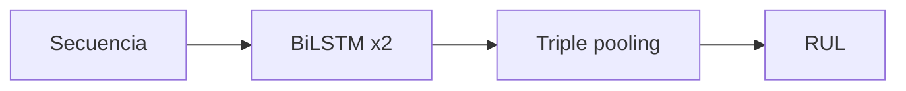

# Esquema — BiLSTM triple pooling

> Nota de repaso rápido. Teoría completa: [[08-bilstm-triple-pooling]]

## La idea en una frase

> Dos lecturas, tres miradas, una predicción que gana pero tiembla.

## Las N piezas

| Pieza | Qué es | Analogía |
|---|---|---|
| 2×BiLSTM 64 | Lee en ambos sentidos | Leer al derecho y al revés |
| Triple pooling | Final + media + pico | Tres fotos distintas |
| 5.637 ± 0.757 | Gana pero tiembla | Rápido pero irregular |

## El flujo (memorizar el orden)

## Sí / No (trampas frecuentes)

- ✅ Early stopping se decide en el holdout (motor 16).
- ❌ Más épocas siempre ayuda (para a las 8–12).

## Flashcards #flashcards

- ¿RMSE del BiLSTM solo (semilla 42)? :: 5.637.
- ¿Qué tres poolings concatena? :: Último paso, media global y máximo global.

## Estado

- [ ] En curso
