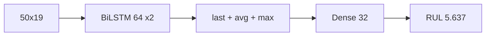

# BiLSTM con triple pooling temporal

## Idea central

Dos capas BiLSTM de 64 que leen la ventana en ambos sentidos, y tres lecturas de su salida (último paso, media, máximo) concatenadas antes de predecir.

> Lee la película al derecho y al revés, y resume con tres miradas: el final, el promedio y el pico.

## ¿Qué problema resuelve?

La degradación es un proceso temporal con principio, desarrollo y final abrupto. Una sola lectura (p. ej. solo el último paso) pierde el contexto; las tres juntas capturan nivel, tendencia y eventos.

## Las piezas del modelo mental

### Arquitectura

`Input(50,19)` → BatchNorm → BiLSTM(64, return_sequences) → Dropout 0.2 → BiLSTM(64) → Dropout → concat[LastStep, GlobalAvg, GlobalMax] → Dropout → Dense(32, relu) → Dense(1) (`src/ds02_rul/model.py:build_champion_bilstm`).

### LastStepPooling registrada

Capa propia en `src/ds02_rul/pooling.py` con `get_config`: el `.keras` se guarda por valor y carga en cualquier Python. Un `Lambda` habría atado el artefacto a una versión (`marshal` cambia entre versiones).

### Entrenamiento

Adam 1e-3, pérdida Huber (delta 10, robusta a atípicos), EarlyStopping por `val_loss` en el holdout (patience 5) + ReduceLROnPlateau. Semilla 42: 9–12 épocas, ~166 s. RMSE 5.637.

## El proceso completo, sin centrarnos en las cuentas

## Qué no debemos confundir

| Concepto | Qué significa | Qué no significa |
|---|---|---|
| Bidireccional | Lee pasado y futuro de la ventana | Ver el futuro real |
| Triple pooling | Tres resúmenes complementarios | Tres modelos |

## Conexión con el aprendizaje

Es el campeón caro: gana al LightGBM (5.637 vs 7.113) pero baila entre semillas (±0.757), lo que motivará el ensamble.

## Conexión con los notebooks del repositorio

- `01_datos_y_bases.ipynb`, celdas 19–20 (construcción con `build_champion_bilstm`, curva de entrenamiento).
- `src/ds02_rul/model.py`, `src/ds02_rul/pooling.py:LastStepPooling`.

## Resumen para recordar

> Dos lecturas, tres miradas, una predicción que gana pero tiembla.

## Autoevaluación

1. ¿Qué aporta cada uno de los tres poolings?
2. ¿Por qué Huber y no MSE?
3. ¿Por qué una capa registrada en vez de Lambda?
