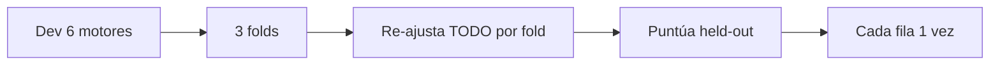

# OOF agrupado por motores

## Idea central

Cada ventana de dev es puntuada exactamente una vez por modelos que nunca la vieron: 3 folds que puntúan [2,10], [5,18] y [20,16] re-entrenando todo (prepro incluida) cada vez.

> Out-of-fold = examen con tribunal que no te ha dado clase nunca.

## ¿Qué problema resuelve?

Necesitamos predicciones honestas de las bases sobre dev para elegir beta y calibrar la banda. Puntuar con el modelo ya ajustado en esas filas sería autoexamen (el defecto 0.308 vs 4.221 de la versión anterior).

## Las piezas del modelo mental

### Refit completo por fold

`oof_base_predictions` (`src/ds02_rul/pipeline.py`): por fold re-ajusta scalers, poly, ridges, LGBM y BiLSTM (15 épocas) solo con los motores de entrenamiento del fold. ~270 s en total.

### Cobertura exactamente 1

`assert` de que cada ventana se puntúa una y solo una vez, y de que fit/score no comparten motor. Si falla, la función explota en vez de mentir.

### Mismas ventanas

La rejilla de ventanas es idéntica entre folds (mismas unidades, mismo step): las predicciones alinean fila a fila.

## El proceso completo, sin centrarnos en las cuentas

## Qué no debemos confundir

| Concepto | Qué significa | Qué no significa |
|---|---|---|
| OOF | Predicción de quien no te entrenó | Predicción del modelo final |
| Coverage 1 | Cada fila puntuada una vez | Cada fila entrenada una vez |

## Conexión con el aprendizaje

Es la maquinaria que hace honesta la elección de beta: sin OOF no hay beta fiable.

## Conexión con los notebooks del repositorio

- `02_decision_ablacion_oof_ensamble.ipynb`, celda 14 (OOF 269.9 s, tiempos por fold).
- `src/ds02_rul/pipeline.py:oof_base_predictions`.

## Resumen para recordar

> Cada fila, un tribunal virgen; cobertura exactamente uno.

## Autoevaluación

1. ¿Por qué se re-entrena el prepro en cada fold y no se reutiliza?
2. ¿Qué pasaría si fit y score compartieran un motor?
3. ¿Para qué se usa el OOF después? (beta + calibración de banda.)
