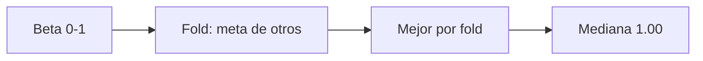

# Beta por mediana y diagnóstico in-sample

## Idea central

Beta mezcla base y meta (`lstm + beta·(meta − lstm)`); se elige por mediana de los 3 folds OOF → 1.00, con dispersión {0.0, 1.0} a la vista.

> Beta dice cuánto caso le haces al meta: 0 = solo BiLSTM, 1 = todo el meta.

## ¿Qué problema resuelve?

Elegir beta sobre las mismas filas que ajustaron el meta daba 0.308 de RMSE (autoexamen). Eligiendo fuera de fold, beta=1.00 es honesto y reproducible.

## Las piezas del modelo mental

### Grid y criterio

21 valores 0.00–1.00; por fold se minimiza `rmse/rmse_ref + nasa/nasa_ref` (`src/ds02_rul/stacking.py:select_beta_grouped`). Folds: 1.00, 1.00, 0.00 → mediana 1.00.

### El fold que discrepa

Fold 2 ([16,20]) pide 0.00: su RMSE 5.889 ≈ referencia 5.893, el meta no aporta ahí. Publicar el desacuerdo es honestidad, no ruido.

### Diagnóstico in-sample

`in_sample_beta_diagnostic` reproduce el protocolo viejo a propósito: cociente 0.716x (muy por debajo de 1 = firma del defecto). Se conserva para que el error no viva solo en prosa.

## El proceso completo, sin centrarnos en las cuentas

## Qué no debemos confundir

| Concepto | Qué significa | Qué no significa |
|---|---|---|
| Mediana | Robusta al fold discrepante | Media |
| 0.716x | Firma del autoexamen | Buen resultado |

## Conexión con el aprendizaje

Es la decisión central del proyecto, tomada sin mirar el test y con el desacuerdo publicado.

## Conexión con los notebooks del repositorio

- `02_decision_ablacion_oof_ensamble.ipynb`, celdas 15 (beta_hat + spread) y 16 (diagnóstico legado).
- `src/ds02_rul/stacking.py:select_beta_grouped`, `in_sample_beta_diagnostic`.

## Resumen para recordar

> Beta 1.00 por mediana honesta; el 0.716x queda como museo del error.

## Autoevaluación

1. ¿Por qué mediana y no media de los betas?
2. ¿Qué cuenta el criterio `rmse/rmse_ref + nasa/nasa_ref`?
3. ¿Para qué conservar el diagnóstico del protocolo defectuoso?
