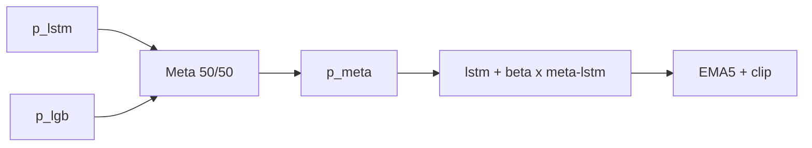

# Stacking híbrido (fórmula final)

## Idea central

El híbrido reconcilia dos ramas independientes con un meta-aprendiz 50/50 y las contrae con beta: `p = lstm + 1.00·(meta − lstm)`, más EMA5 y clip a cero.

> Dos opiniones (secuencia y tabla) + un árbitro (meta) + un volumen (beta) + un pulso firme (EMA).

## ¿Qué problema resuelve?

El BiLSTM ve orden pero tiembla (±0.757); el LightGBM es estable pero corto (7.113). El meta aprende a combinarlos y beta decide cuánto fiarse, todo elegido fuera de fold. Resultado semilla 42: RMSE 4.275, NASA 2314.8.

## Las piezas del modelo mental

### Meta 50/50

`RidgeCV` + `LGBMRegressor` sobre `[p_lstm, p_lgb]` (más ciclo/100 en el diseño enviado), ajustados en el holdout 16 (`fit_meta_learners`). Ridge coef [0.1034, 0.7913]: pesa más el BiLSTM.

### Beta = 1.00

Todo el meta: `p_raw = p_lstm + 1.0·(p_meta − p_lstm)`. Con beta 0 sería BiLSTM puro.

### `HybridStackingEnsemble.predict`

`src/ds02_rul/ensemble.py:predict`: reescala, reconstruye secuencia y tabla con los objetos del artefacto, aplica meta según el ancho que trae (`n_features`), mezcla, EMA5 por motor, clip ≥ 0. Exige `units` (sin ellas avisa: suavizaría mezclando motores).

## El proceso completo, sin centrarnos en las cuentas

## Qué no debemos confundir

| Concepto | Qué significa | Qué no significa |
|---|---|---|
| Meta | Aprende a combinar predicciones | Otro modelo de sensores |
| Beta | Volumen del meta (0–1) | Peso entrenado por gradiente |

## Conexión con el aprendizaje

Es la fórmula que hay que saber escribir de memoria: todo el proyecto desemboca en esta línea.

## Conexión con los notebooks del repositorio

- `02_decision_ablacion_oof_ensamble.ipynb`, celdas 18–19 (meta en motor 16, tabla titular 4.275).
- `src/ds02_rul/ensemble.py:HybridStackingEnsemble`, `stacking.py:fit_meta_learners/meta_predict`.

## Resumen para recordar

> Meta 50/50, beta 1.00, EMA5, clip: 4.275.

## Autoevaluación

1. Escribe la fórmula del híbrido de memoria.
2. ¿Por qué el meta se ajusta en el motor 16?
3. ¿Qué pasaría con beta = 0?
