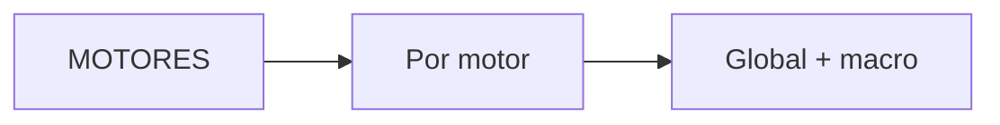

# Esquema — Macro-RMSE

> Nota de repaso rápido. Teoría completa: [[15-macro-rmse]]

## La idea en una frase

> El peor motor también vota: macro 4.878 frente a global 4.275.

## Las N piezas

| Pieza | Qué es | Analogía |
|---|---|---|
| Motor 14 | 8.04, el que falla | El alumno que baja la media |
| Macro | Media de motores | Un voto por alumno |
| NASA | Penalización asimétrica | Suspenso caro por pasarse |

## El flujo (memorizar el orden)

## Sí / No (trampas frecuentes)

- ✅ Publicar global y macro con la diferencia explicada.
- ❌ Quedarse solo con el global (esconde al 14).

## Flashcards #flashcards

- ¿RMSE por motor del híbrido? :: 11: 3.79, 14: 8.04, 15: 2.80.
- ¿Qué castiga más la NASA? :: Pasarse de RUL (exp(d/10)).

## Estado

- [ ] En curso
