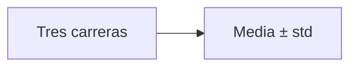

# Esquema — Multisemilla

> Nota de repaso rápido. Teoría completa: [[16-multisemilla]]

## La idea en una frase

> Híbrido 4.352 ± 0.099: gana y no tiembla.

## Las N piezas

| Pieza | Qué es | Analogía |
|---|---|---|
| 3 semillas | 42, 7, 123 | Tres dados |
| Híbrido ±0.099 | Roca | Mesa que no cojea |
| BiLSTM ±0.757 | Tiembla | Mesa que cojea |

## El flujo (memorizar el orden)

## Sí / No (trampas frecuentes)

- ✅ Juzgar por media ± std, nunca por la mejor semilla.
- ❌ Una semilla basta (es anécdota).

## Flashcards #flashcards

- ¿Híbrido multisemilla? :: 4.352 ± 0.099.
- ¿BiLSTM multisemilla? :: 6.437 ± 0.757.

## Estado

- [ ] En curso
