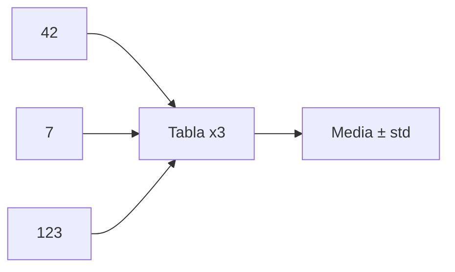

# Multisemilla (media ± std entre 42, 7 y 123)

## Idea central

Correr todo con 3 semillas y publicar media ± desviación distingue victoria real de suerte de inicialización.

> Una semilla es una anécdota; tres semillas con su ± es evidencia.

## ¿Qué problema resuelve?

El BiLSTM baila con la semilla (5.637 → 6.530 → 7.143). Juzgar por una sola semilla confundiría ruido con mérito. El ± entre semillas es el equivalente honesto del ± entre folds de clase.

## Las piezas del modelo mental

### `seed_summary`

`src/ds02_rul/pipeline.py:seed_summary`: agrupa por modelo y calcula media ± std muestral de RMSE/MAE/R²/NASA.

### Números

Híbrido 4.352 ± 0.099 (roca), BiLSTM 6.437 ± 0.757 (tiembla), LightGBM 7.098 ± 0.034 (clavado). Cada semilla, un punto en `dispersion_por_semilla`.

### Coste

Tres `run_seed` completos (LGBM ~0.6 s + BiLSTM ~110–170 s cada uno): la parte lenta del NB03.

## El proceso completo, sin centrarnos en las cuentas

## Qué no debemos confundir

| Concepto | Qué significa | Qué no significa |
|---|---|---|
| ± entre semillas | Estabilidad del método | Error de medida |
| 3 semillas | Suficiente para ver el baile | Prueba estadística formal |

## Conexión con el aprendizaje

Es el "±" de la regla del empate: sin multisemilla no hay veredicto defendible.

## Conexión con los notebooks del repositorio

- `03_evidencia_multisemilla_diagnostico.ipynb`, celdas 7–9 (filas por semilla, `seed_summary`, dispersión).
- `src/ds02_rul/pipeline.py:run_seed/seed_summary`.

## Resumen para recordar

> Híbrido 4.352 ± 0.099: gana y no tiembla; el BiLSTM tiembla ±0.757.

## Autoevaluación

1. ¿Por qué el BiLSTM varía tanto y el LightGBM tan poco?
2. ¿Qué significa que el híbrido tenga std 0.099?
3. ¿Por qué 3 semillas y no 10?
