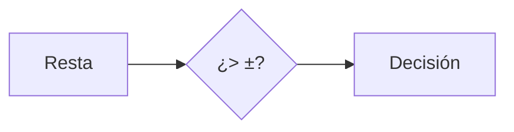

# Esquema — Regla del empate

> Nota de repaso rápido. Teoría completa: [[17-regla-del-empate]]

## La idea en una frase

> 2.085 contra un ± de 0.757: victoria, no empate.

## Las N piezas

| Pieza | Qué es | Analogía |
|---|---|---|
| Resta | 1º − 2º = 2.085 | La foto finish |
| ± | Ruido entre semillas | El margen del cronómetro |
| Victoria | Supera el ruido en todo | Ganar por un cuerpo |

## El flujo (memorizar el orden)

## Sí / No (trampas frecuentes)

- ✅ Elegir con regla escrita y reproducible.
- ❌ Elegir "el que más me gusta".

## Flashcards #flashcards

- ¿Mejora del híbrido sobre el BiLSTM? :: −2.085 RMSE (−32.4%).
- Si dif < ±, ¿qué se elige? :: El modelo más simple.

## Estado

- [ ] En curso
