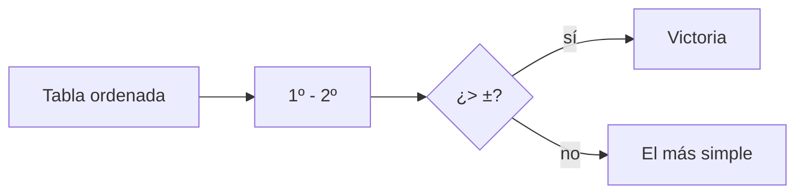

# Regla del empate y elección

## Idea central

Se resta 1º − 2º; si la diferencia supera ambos ±, victoria; si no, empate y se elige el más simple. Aquí: 2.085 > 0.757 → VICTORIA del híbrido.

> La regla que convierte una tabla en una decisión firmable.

## ¿Qué problema resuelve?

Sin regla explícita, elegir es gusto. Con regla, cualquiera con la tabla llega a la misma conclusión: el híbrido gana las 4 métricas por margen mayor que el ruido.

## Las piezas del modelo mental

### La resta

BiLSTM 6.437 − híbrido 4.352 = 2.085 ciclos de mejora (32.4%).

### Los ±

Híbrido ±0.099, BiLSTM ±0.757. La diferencia los supera a ambos con holgura: no hay empate posible.

### El acta

Celda "¿Cuál elegimos?" + celda de regla por escrito (NB03 celdas 28–30): la frase que se dice en la defensa.

## El proceso completo, sin centrarnos en las cuentas

## Qué no debemos confundir

| Concepto | Qué significa | Qué no significa |
|---|---|---|
| Victoria | Supera el ruido en las 4 métricas | Gana por poco en una |
| Test | Comprueba que la validación dijo verdad | El que elige |

## Conexión con el aprendizaje

Es el cierre del método de clase adaptado: la misma regla del ±, con semillas en vez de folds.

## Conexión con los notebooks del repositorio

- `03_evidencia_multisemilla_diagnostico.ipynb`, celdas 28–30 (elección + regla por escrito).
- Mejoras: −38.7% RMSE vs LightGBM, −32.4% vs BiLSTM.

## Resumen para recordar

> 2.085 contra un ± de 0.757: victoria, no empate.

## Autoevaluación

1. ¿Qué harías si la diferencia fuera 0.05 con ± de 0.1?
2. ¿Por qué se exige ganar en las 4 métricas?
3. ¿Qué papel juega el test en la elección? (Ninguno: solo comprueba.)
