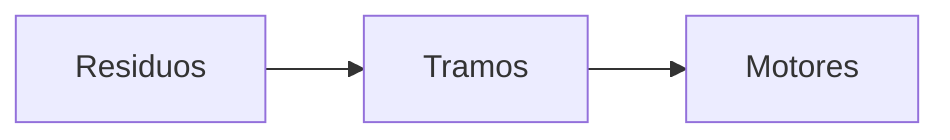

# Esquema — Diagnóstico

> Nota de repaso rápido. Teoría completa: [[18-diagnostico]]

## La idea en una frase

> Cerca del fallo clava, lejos se abre, el 14 sangra.

## Las N piezas

| Pieza | Qué es | Analogía |
|---|---|---|
| Tramos ×4.4 | Error lejos del fallo | Niebla a lo lejos |
| Motor 14 | 8.04, pocas ventanas | El partido fuera de casa |
| Sesgo 0.369 | Nulo | Balanza equilibrada |

## El flujo (memorizar el orden)

## Sí / No (trampas frecuentes)

- ✅ Publicar dónde falla con números.
- ❌ Solo publicar la media global.

## Flashcards #flashcards

- ¿Sesgo medio del híbrido? :: +0.369 ciclos, nulo.
- ¿Qué motor concentra el error? :: El 14, RMSE 8.0445.

## Estado

- [ ] En curso
