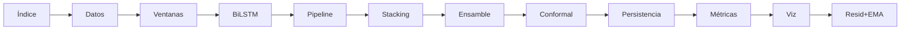

# Índice de funciones y API

## Idea central

Mapa completo de las 64 funciones/clases de `src/ds02_rul/`: firma, contrato y dónde se llaman. Es la puerta de entrada al bloque B7.

> Si quieres saber **cómo se llama exactamente** una función, empieza aquí.

## ¿Qué problema resuelve?

Las notas B1–B6 explican la mecánica; los anexos dicen qué imprime cada celda; pero falta el eslabón: *qué función se invoca, con qué argumentos y qué devuelve*. Este índice lo da en una tabla.

## Las piezas del modelo mental

### Las 12 notas de B7

| Nodo | Archivo | Cubre |
|---|---|---|
| N21 | `21-api-datos-e-ingestion` | resolve_ds02, load_ds02, load_fd001_reference, data_fingerprint |
| N22 | `22-api-ventanas-e-inferencia` | build_windows, per_unit_baseline, raw_windows, windows_for_unit, validate_window |
| N23 | `23-api-modelo-bilstm-y-pooling` | build_champion_bilstm, fit_bilstm, LastStepPooling |
| N24 | `24-api-pipeline-y-semillas` | make_lgbm, run_seed, oof_base_predictions, ablation_table, seed_summary, _row, nasa |
| N25 | `25-api-stacking-interno` | MetaSpec, meta_design, fit_meta, predict_meta, grouped_folds, fit_meta_learners, meta_predict, score_beta_holdout, select_beta_grouped, in_sample_beta_diagnostic |
| N26 | `26-api-ensamble-e-intervalos` | HybridStackingEnsemble (__init__, _resolve_model, predict, predict_interval, _sequence, _tabular) |
| N27 | `27-api-conformal` | _bin_index, fit_conformal, apply_conformal, empirical_coverage |
| N28 | `28-api-persistencia-y-reload` | sha256_of, build_manifest, assert_ds02_artifact, save_ensemble, _detached_copy, load_bilstm, load_ensemble, write_manifest |
| N29 | `29-api-metricas` | calculate_nasa_score, macro_rmse, evaluate_predictions |
| N30 | `30-api-visualizacion` | todos los viz.py (incl. gaps) |
| N31 | `31-api-residualizador-y-suavizado` | SensorResidualizer, causal_ema_by_unit |

### Convención de cada nota B7

Cada nota trae: **firma**, **parámetros**, **retorno (formas)**, **llamado desde** (celda del notebook), **ejemplo mínimo**, **gotchas**.

## El proceso completo, sin centrarnos en las cuentas

## Qué no debemos confundir

| Concepto | Qué significa | Qué no significa |
|---|---|---|
| Nodo B7 | Referencia de API (firma/contrato) | Sustituto de los notebooks |
| Firma | Contrato de entrada/salida | Implementación interna |

## Conexión con los notebooks del repositorio

- `notebooks/ds02_ensemble/01_datos_y_bases.ipynb`, `02_decision_ablacion_oof_ensamble.ipynb`, `03_evidencia_multisemilla_diagnostico.ipynb`.
- `src/ds02_rul/*.py` (64 funciones/clases).

## Resumen para recordar

> B7 es el diccionario del código: firma, contrato, dónde se llama.

## Autoevaluación

1. ¿Dónde busco la firma de `predict_interval`?
2. ¿Qué nodo cubre `LastStepPooling`?
3. ¿Para qué sirve el bloque B7 frente a B1–B6?

## Estado

- [ ] En curso
