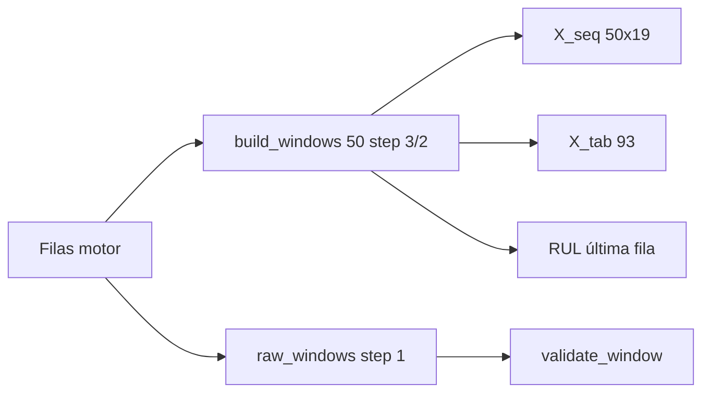

# API — Ventanas e inferencia

## Idea central

Cómo se cortan ventanas, cómo se calcula la línea base por motor, y cómo se validan ventanas en la vía en vivo. `src/ds02_rul/features.py` + `inference.py`.

> Una ventana = 50 filas consecutivas; su etiqueta es el RUL de la última fila.

## ¿Qué problema resuelve?

El modelo no ve filas sueltas: ve bloques. Y en producción (Casos nuevos) hay que validar que el bloque que llega tiene la forma correcta y no contiene NaN.

## Las piezas del modelo mental

### `build_windows(W, Xs, units, cycles, y, window=50, step=3/2, use_cycle=True)` (`features.py:79`)
- **Firma:** `build_windows(W_raw, Xs_raw, units, cycles, y, window_size=50, step=3, use_cycle=True)`.
- **Qué hace:** corta ventanas deslizantes; X_seq=(N,50,19), X_tab=(N,93); y = RUL de la última fila.
- **Retorno:** `(X_seq, X_tab, y, meta)` con meta por ventana (unidad, ciclo final).
- **Llamado desde:** NB01 celda 13 (dev 17 450 ventanas, test 6 196).
- **Gotcha:** `step` distinto en train (3) y test (2); `use_cycle=False` apaga el canal 19 (ablación).

### `per_unit_baseline(res, units, cycles) -> dict` (`features.py:63`)
- **Firma:** `per_unit_baseline(res: np.ndarray, units, cycles) -> dict`.
- **Qué hace:** media sana de cada motor con sus primeros `BASE_CYCLES=3` ciclos (calibración causal).
- **Retorno:** dict unidad → vector de medias.
- **Llamado desde:** NB02 (ablación). Usado en `residualizer`.
- **Gotcha:** solo usa los 3 primeros ciclos → causal, no fuga.

### `raw_windows(W, Xs, units, cycles, window=50, step=1)` (`inference.py:14`)
- **Firma:** `raw_windows(..., window: int = 50, step: int = 1)`.
- **Qué hace:** genera ventanas crudas (sin prepro) para la vía en vivo (Casos nuevos).
- **Retorno:** lista de arrays (window, n_features).
- **Llamado desde:** `dashboard_ds02.py` (Casos nuevos) vía `ui_inference`.
- **Gotcha:** step=1 por defecto (más denso que el cache, que va a step=2).

### `windows_for_unit(W, Xs, units, cycles, unit, window=50, step=1)` (`inference.py:49`)
- **Firma:** `windows_for_unit(..., unit: float, window=50, step=1)`.
- **Qué hace:** filtra `raw_windows` a un único motor.
- **Retorno:** lista de ventanas de esa unidad.
- **Llamado desde:** `dashboard_ds02.py` ("Explora por ciclo").
- **Gotcha:** si el motor no existe, devuelve lista vacía (no lanza).

### `validate_window(X, window=50) -> np.ndarray` (`inference.py:62`)
- **Firma:** `validate_window(X, window: int = 50) -> np.ndarray`.
- **Qué hace:** comprueba forma (50, n_features) y ausencia de NaN/Inf; lanza si inválida.
- **Retorno:** array validado.
- **Llamado desde:** `ui_inference.validate_table` (Casos nuevos).
- **Gotcha:** rechaza ±inf (fix reciente) y valida antes de predecir.

## El proceso completo, sin centrarnos en las cuentas

## Qué no debemos confundir

| Concepto | Qué significa | Qué no significa |
|---|---|---|
| window 50 | 50 filas muestreadas (stride 100) | 50 ciclos de vuelo reales |
| step 3/2 | separación entre ventanas train/test | tamaño de ventana |
| use_cycle | canal 19 (cyc_norm) on/off | fuga (es medible en producción) |

## Conexión con los notebooks del repositorio

- `notebooks/ds02_ensemble/01_datos_y_bases.ipynb` celdas 13, 15.
- `src/ds02_rul/features.py:63,79` + `inference.py:14,49,62`.

## Resumen para recordar

> build_windows → X_seq (N,50,19) + X_tab (N,93) + y (RUL última fila). En vivo: raw_windows + validate_window.

## Autoevaluación

1. ¿Qué es la etiqueta de una ventana?
2. ¿Qué diferencia hay entre build_windows y raw_windows?
3. ¿Qué valida validate_window?

## Estado

- [ ] En curso
