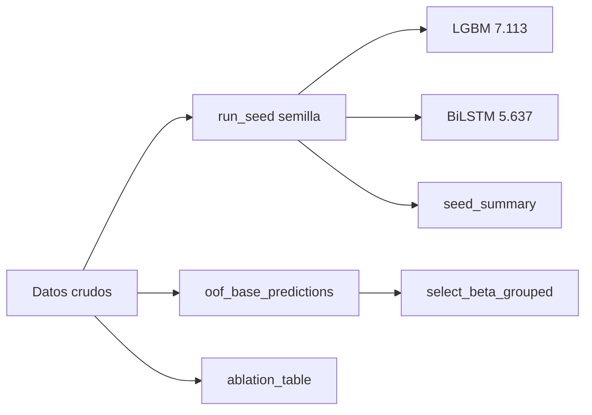

# API — Pipeline y semillas

## Idea central

Orquestación de un experimento completo para una semilla: LightGBM + BiLSTM, OOF, ablación. `src/ds02_rul/pipeline.py`.

> `run_seed` es el corazón: de un dict de datos crudos saca todas las métricas de una semilla.

## ¿Qué problema resuelve?

Hay que repetir el mismo experimento con varias semillas (42, 123, 456) y agregar. `run_seed` encapsula una corrida entera; `seed_summary` agrega.

## Las piezas del modelo mental

### `make_lgbm(seed) -> LGBMRegressor` (`pipeline.py:46`)
- **Firma:** `make_lgbm(seed: int) -> LGBMRegressor`.
- **Qué hace:** crea un LightGBM cuantil (alpha=0.35) con la semilla dada.
- **Retorno:** modelo no entrenado.
- **Llamado desde:** NB01 celda 15, `run_seed`, `ablation_table`.
- **Gotcha:** objetivo `quantile`, no `regression`.

### `fit_bilstm(...)` → ver N23.

### `_row(units, cycles, y, pred, name)` (`pipeline.py:78`)
- **Firma:** `_row(units, cycles, y, pred, name)`.
- **Qué hace:** construye una fila de resultados (RMSE/MAE/R2/NASA/macro) para un modelo.
- **Retorno:** dict.
- **Llamado desde:** `run_seed`, `seed_summary`.
- **Gotcha:** función interna (prefijo `_`), no llamar desde fuera.

### `run_seed(raw, seed, fit_units, holdout_units, test_units, ...)` (`pipeline.py:88`)
- **Firma:** `run_seed(raw, seed, fit_units, holdout_units, test_units, window=50, step_train=3, step_test=2, epochs=22)`.
- **Qué hace:** pipeline completo para una semilla: prepro, ventanas, LGBM, BiLSTM (early stop en holdout), evaluación en test.
- **Retorno:** dict con métricas por modelo + predicciones.
- **Llamado desde:** NB01 celda 21, NB03 celda 8.
- **Gotcha:** ~65 s por semilla (BiLSTM). No ejecutar en render.

### `oof_base_predictions(raw, dev_units, n_splits=3, seed=42, ...)` (`pipeline.py:157`)
- **Firma:** `oof_base_predictions(raw, dev_units, n_splits=3, seed=42)`.
- **Qué hace:** OOF agrupado por motor: re-entrena TODO por fold, puntúa held-out, cobertura exactamente 1.
- **Retorno:** `(pred_lstm, pred_lgb)` arrays alineados a las ventanas dev.
- **Llamado desde:** NB02 celda 16.
- **Gotcha:** ~270 s total. Assert de cobertura 1 (explota si falla).

### `seed_summary(rows) -> pd.DataFrame` (`pipeline.py:235`)
- **Firma:** `seed_summary(rows: list) -> pd.DataFrame`.
- **Qué hace:** agrega resultados de varias semillas (media ± std).
- **Retorno:** DataFrame resumen.
- **Llamado desde:** NB03 celda 9.

### `ablation_table(raw, seeds=(42,), window=50, step_train=3, ...)` (`pipeline.py:247`)
- **Firma:** `ablation_table(raw, seeds=(42,), window=50, step_train=3, step_test=2)`.
- **Qué hace:** 4 variantes (cyc_norm ON/OFF × baseline delta ON/OFF), re-entrena LGBM+BiLSTM.
- **Retorno:** DataFrame con RMSE por variante.
- **Llamado desde:** NB02 celda 9.
- **Gotcha:** caro (4 re-entrenos). Resultado clave: +0.355 RMSE al quitar cyc_norm.

### `nasa(y, p) -> float` (`pipeline.py:290`)
- **Firma:** `nasa(y, p) -> float`.
- **Qué hace:** NASA score asimétrico (castiga tarde).
- **Retorno:** float.
- **Llamado desde:** `calculate_nasa_score` (metrics.py), NB01.

## El proceso completo, sin centrarnos en las cuentas

## Qué no debemos confundir

| Concepto | Qué significa | Qué no significa |
|---|---|---|
| run_seed | Una corrida completa (semilla) | Todo el experimento |
| seed_summary | Agregación de semillas | Una sola semilla |
| OOF | Predicción honesta (tribunal virgen) | Predicción del modelo final |

## Conexión con los notebooks del repositorio

- `notebooks/ds02_ensemble/01_datos_y_bases.ipynb` celdas 15, 17, 20, 21.
- `notebooks/ds02_ensemble/02_decision_ablacion_oof_ensamble.ipynb` celda 9.
- `notebooks/ds02_ensemble/03_evidencia_multisemilla_diagnostico.ipynb` celdas 8, 9.
- `src/ds02_rul/pipeline.py:46,50,78,88,157,235,247,290`.

## Resumen para recordar

> run_seed(semilla) → LGBM + BiLSTM + métricas. seed_summary agrega. OOF da predicciones honestas para beta y banda.

## Autoevaluación

1. ¿Qué hace `run_seed` de principio a fin?
2. ¿Por qué el OOF re-entrena todo por fold?
3. ¿Qué mide `ablation_table` y cuál es el resultado clave?

## Estado

- [ ] En curso
