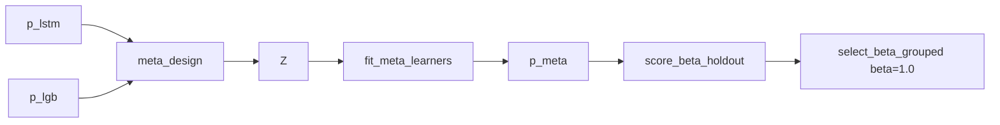

# API — Stacking interno

## Idea central

El árbitro del ensamble: meta-aprendiz 50/50 (Ridge + LightGBM) sobre `[p_lstm, p_lgb]`, y la elección de beta por holdout agrupado. `src/ds02_rul/stacking.py`.

> Dos opiniones + un árbitro + un volumen (beta).

## ¿Qué problema resuelve?

El BiLSTM gana pero tiembla (±0.757); el LightGBM es estable pero corto. El meta aprende a combinarlos; beta decide cuánto fiarse, todo elegido fuera de fold.

## Las piezas del modelo mental

### `MetaSpec` (dataclass) (`stacking.py:30`)
- **Firma:** `@dataclass MetaSpec(use_cycle=True, include_cycle_feature=True, ...)`.
- **Qué hace:** configuración del meta-aprendiz (qué features incluye).
- **Retorno:** instancia.
- **Gotcha:** `__post_init__` valida.

### `meta_design(p_lstm, p_lgb, spec=MetaSpec()) -> np.ndarray` (`stacking.py:74`)
- **Firma:** `meta_design(p_lstm, p_lgb, spec) -> np.ndarray`.
- **Qué hace:** construye la matriz Z para el meta (columnas p_lstm, p_lgb, + ciclo/100).
- **Retorno:** array (N, n_features).

### `fit_meta(Z, y, spec, seed=42) -> dict` (`stacking.py:84`)
- **Firma:** `fit_meta(Z, y, spec, seed=42) -> dict`.
- **Qué hace:** ajusta RidgeCV + LGBMRegressor sobre Z.
- **Retorno:** dict con `ridge`, `lgbm`, `spec`.

### `predict_meta(meta, p_lstm, p_lgb) -> np.ndarray` (`stacking.py:128`)
- **Firma:** `predict_meta(meta, p_lstm, p_lgb) -> np.ndarray`.
- **Qué hace:** predicción del meta (media 50/50 de ridge y lgbm).

### `grouped_folds(units, n_splits=3, seed=42)` (`stacking.py:146`)
- **Firma:** `grouped_folds(units, n_splits=3, seed=42)`.
- **Qué hace:** folds agrupados por motor (held-out units), reproducibles con seed.
- **Retorno:** lista de arrays de units.

### `fit_meta_learners(Z, y, seed=42)` (`stacking.py:161`)
- **Firma:** `fit_meta_learners(Z, y, seed=42)`.
- **Qué hace:** ajusta ridge + lgbm y devuelve ambos.
- **Retorno:** `(ridge, lgbm)`.

### `meta_predict(ridge, lgbm, Z) -> np.ndarray` (`stacking.py:184`)
- **Firma:** `meta_predict(ridge, lgbm, Z) -> np.ndarray`.
- **Qué hace:** media de las dos predicciones.

### `score_beta_holdout(p_meta, p_lstm, y, units, cycles, beta_grid, ...)` (`stacking.py:192`)
- **Firma:** `score_beta_holdout(p_meta, p_lstm, y, units, cycles, beta_grid=BETA_GRID, ...)`.
- **Qué hace:** evalúa RMSE por beta en el holdout (motor 16).
- **Retorno:** dict beta → RMSE.

### `select_beta_grouped(...)` (`stacking.py:234`)
- **Firma:** `select_beta_grouped(...)`.
- **Qué hace:** elige beta agrupando por motor (no promedio simple).
- **Retorno:** beta seleccionado + diagnóstico.
- **Llamado desde:** NB02 celda 17.
- **Gotcha:** dos folds piden 1.00, uno 0.00 → acuerdo parcial publicado.

### `in_sample_beta_diagnostic(...)` (`stacking.py:368`)
- **Firma:** `in_sample_beta_diagnostic(...)`.
- **Qué hace:** diagnóstico in-sample de beta (para el "trap" de leakage).
- **Retorno:** dict.

## El proceso completo, sin centrarnos en las cuentas

## Qué no debemos confundir

| Concepto | Qué significa | Qué no significa |
|---|---|---|
| Meta | Aprende a combinar predicciones | Otro modelo de sensores |
| Beta | Volumen del meta (0–1) | Peso entrenado por gradiente |
| grouped | Por motor, no promedio simple | Media aritmética |

## Conexión con los notebooks del repositorio

- `notebooks/ds02_ensemble/02_decision_ablacion_oof_ensamble.ipynb` celdas 16, 17, 18, 20.
- `src/ds02_rul/stacking.py:30,74,84,128,146,161,184,192,234,368`.

## Resumen para recordar

> Meta 50/50 (Ridge+lgbm), beta=1.00 por holdout agrupado, EMA5, clip. Fórmula: p = lstm + beta·(meta − lstm).

## Autoevaluación

1. Escribe la fórmula del híbrido de memoria.
2. ¿Por qué el meta se ajusta en el motor 16?
3. ¿Qué pasaría con beta = 0?

## Estado

- [ ] En curso
