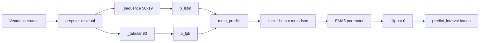

# API — Ensamble e intervalos

## Idea central

El objeto desplegado: reescala, reconstruye secuencia/tabular, aplica meta según el ancho, mezcla, EMA5 por motor, clip. Y además da intervalos conformal. `src/ds02_rul/ensemble.py`.

> El ensamble es el que realmente se guarda y se carga en producción.

## ¿Qué problema resuelve?

En producción no se re-entrena: se carga el artefacto y se predice. `HybridStackingEnsemble` encapsula todo el flujo de inferencia (prepro + meta + EMA + banda) en un solo objeto serializable.

## Las piezas del modelo mental

### `HybridStackingEnsemble` (`ensemble.py:23`)
- **Clase:** contenedor del artefacto.
- **`__init__(...)`** (`ensemble.py:49`): recibe bilstm, lgbm, scaler, residualizer, meta, beta, conformal, etc. Guarda todo.
- **`_resolve_model()`** (`ensemble.py:82`): resuelve qué modelo usar según `n_features` del meta.
- **`predict(X_raw_windows, cycles, units=None) -> np.ndarray`** (`ensemble.py:101`): predicción puntual (prepro → meta → mezcla beta → EMA5 por motor → clip ≥0).
  - **Gotcha:** exige `units`; sin ellas avisa (suavizaría mezclando motores).
- **`predict_interval(X_raw_windows, cycles, units=None)`** (`ensemble.py:161`): devuelve `(point, lower, upper)` aplicando conformal.
  - **Llamado desde:** NB02 celda 31, `dashboard_ds02.py` (Casos nuevos).
- **`_sequence(X_scaled, cycles, input_shape) -> np.ndarray`** (`ensemble.py:180`): reconstruye X_seq (50,19) para el BiLSTM.
- **`_tabular(X_scaled, cycles) -> np.ndarray`** (`ensemble.py:193`): reconstruye X_tab (93) para el LightGBM.
  - **Gotcha:** deshace el escalado global antes de residualizar (N5).

## El proceso completo, sin centrarnos en las cuentas

## Qué no debemos confundir

| Concepto | Qué significa | Qué no significa |
|---|---|---|
| predict | Predicción puntual | Intervalo |
| predict_interval | Punto + banda conformal | Solo banda |
| units | Agrupa EMA por motor | Opcional (si falta, mezcla motores) |

## Conexión con los notebooks del repositorio

- `notebooks/ds02_ensemble/02_decision_ablacion_oof_ensamble.ipynb` celdas 21, 30, 31.
- `notebooks/ds02_ensemble/03_evidencia_multisemilla_diagnostico.ipynb` celdas 4, 8, 55.
- `src/ds02_rul/ensemble.py:23,49,82,101,161,180,193`.

## Resumen para recordar

> HybridStackingEnsemble: prepro → meta → beta → EMA5 → clip. predict (punto) y predict_interval (punto+banda). Exige units.

## Autoevaluación

1. ¿Qué diferencia hay entre predict y predict_interval?
2. ¿Por qué `_tabular` deshace el escalado global?
3. ¿Qué pasa si no se pasan units a predict?

## Estado

- [ ] En curso
