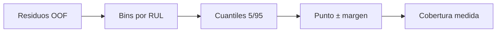

# API — Conformal

## Idea central

Split-conformal asimétrico por tramo de RUL: residuos del OOF agrupados en bins [0,25,50,75,∞), cuantiles 5%/95% por bin. `src/ds02_rul/conformal.py`.

> El punto dice cuándo; la banda dice con qué margen me puedo equivocar.

## ¿Qué problema resuelve?

Un punto no basta para decidir mantenimiento. La banda 90% promete cubrir el RUL real el 90% de las veces, y su ancho crece donde el error crece.

## Las piezas del modelo mental

### `_bin_index(pred, edges) -> np.ndarray` (`conformal.py:21`)
- **Firma:** `_bin_index(pred: np.ndarray, edges) -> np.ndarray`.
- **Qué hace:** asigna cada predicción a su bin según `edges` (default [0,25,50,75,∞]).
- **Retorno:** array de índices de bin.
- **Gotcha:** función interna (prefijo `_`).

### `fit_conformal(y_true, pred, target=0.90, edges=DEFAULT_EDGES, ...) -> dict` (`conformal.py:28`)
- **Firma:** `fit_conformal(y_true, pred, target: float = 0.90, edges=DEFAULT_EDGES, ...)`.
- **Qué hace:** calcula cuantiles 5%/95% por bin a partir de residuos `y − pred`. Bins con <100 filas usan cuantiles globales.
- **Retorno:** dict `calib` con cuantiles por bin.
- **Llamado desde:** NB02 celda 30.
- **Gotcha:** se calibra con OOF (residuos honestos), nunca con test.

### `apply_conformal(pred, calib) -> (lower, upper)` (`conformal.py:90`)
- **Firma:** `apply_conformal(pred, calib: dict)`.
- **Qué hace:** aplica la banda: lower/upper nunca cruzan el punto; cota inferior recortada a 0 si punto ≥0.
- **Retorno:** `(lower, upper)` arrays.
- **Llamado desde:** NB02 celda 31, `predict_interval`.

### `empirical_coverage(y_true, lower, upper) -> float` (`conformal.py:116`)
- **Firma:** `empirical_coverage(y_true, lower, upper) -> float`.
- **Qué hace:** fracción de reales dentro de [lower, upper].
- **Retorno:** float (0–1).
- **Llamado desde:** NB02 celda 31, NB03 celda 14.
- **Gotcha:** en test sale 100% (sobre-cobertura); se publica el trade-off, no se estrecha sobre test.

## El proceso completo, sin centrarnos en las cuentas

## Qué no debemos confundir

| Concepto | Qué significa | Qué no significa |
|---|---|---|
| 90% nominal | Objetivo de diseño | Garantía en 3 motores |
| 100% cobertura | Sobre-cobertura honesta publicada | Mejor banda (es ancha) |
| Asimétrica | q_low ≠ −q_high | Error simétrico |

## Conexión con los notebooks del repositorio

- `notebooks/ds02_ensemble/02_decision_ablacion_oof_ensamble.ipynb` celdas 30, 31.
- `notebooks/ds02_ensemble/03_evidencia_multisemilla_diagnostico.ipynb` celda 14.
- `src/ds02_rul/conformal.py:21,28,90,116`.

## Resumen para recordar

> fit_conformal (OOF) → apply_conformal (pred) → empirical_coverage (medir, no suponer). Banda asimétrica, target 0.9.

## Autoevaluación

1. ¿Por qué la banda es asimétrica?
2. ¿Por qué se calibra con el OOF y no con el test?
3. ¿Qué revela que la banda de motor 16 solo cubra 31.9%?

## Estado

- [ ] En curso
