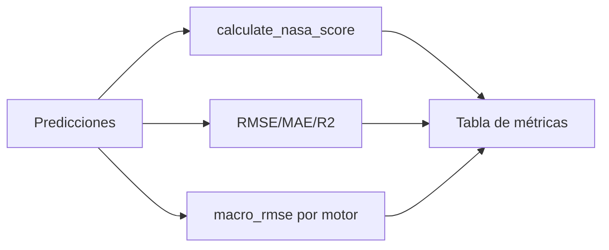

# API — Métricas

## Idea central

Las cuatro métricas que se reportan: NASA score (asimétrico), RMSE, MAE, R2, y el macro-RMSE por motor. `src/ds02_rul/metrics.py`.

> El punto es ciencia; la métrica es el idioma del tribunal.

## ¿Qué problema resuelve?

Un solo número (RMSE global) oculta dónde falla el modelo. El macro-RMSE por motor y el NASA score (que castiga tarde) dan la foto honesta.

## Las piezas del modelo mental

### `calculate_nasa_score(y_true, y_pred) -> float` (`metrics.py:14`)
- **Firma:** `calculate_nasa_score(y_true, y_pred) -> float`.
- **Qué hace:** suma asimétrica del error (castiga más predecir tarde que temprano).
- **Retorno:** float.
- **Llamado desde:** `evaluate_predictions`, NB01 celda 15.

### `macro_rmse(y_true, y_pred, units) -> dict` (`metrics.py:21`)
- **Firma:** `macro_rmse(y_true, y_pred, units) -> dict`.
- **Qué hace:** media de RMSE por motor (no ponderada por nº de ventanas).
- **Retorno:** `{'per_unit_rmse': {...}, 'macro_rmse': float, 'n_units': int}`.
- **Llamado desde:** `evaluate_predictions`, NB02/NB03.
- **Gotcha:** macro ≠ RMSE global (el global pondera por ventanas).

### `evaluate_predictions(y_true, y_pred, model_name="Modelo") -> dict` (`metrics.py:45`)
- **Firma:** `evaluate_predictions(y_true, y_pred, model_name: str = "Modelo") -> dict`.
- **Qué hace:** calcula RMSE, MAE, R2, NASA, macro y devuelve dict + imprime tabla.
- **Retorno:** dict con métricas.
- **Llamado desde:** NB01 celda 17, NB02 celdas 21/23/25, NB03.

## El proceso completo, sin centrarnos en las cuentas

## Qué no debemos confundir

| Concepto | Qué significa | Qué no significa |
|---|---|---|
| NASA score | Suma asimétrica (castiga tarde) | Media del error |
| Macro-RMSE | Media de RMSE por motor | RMSE ponderado por ventanas |
| RMSE global | Ponderado por nº de ventanas | Error típico por motor |

## Conexión con los notebooks del repositorio

- `notebooks/ds02_ensemble/01_datos_y_bases.ipynb` celdas 15, 17.
- `notebooks/ds02_ensemble/02_decision_ablacion_oof_ensamble.ipynb` celdas 21, 23, 25, 27.
- `notebooks/ds02_ensemble/03_evidencia_multisemilla_diagnostico.ipynb` celdas 9, 21.
- `src/ds02_rul/metrics.py:14,21,45`.

## Resumen para recordar

> calculate_nasa_score (asimétrico) + macro_rmse (por motor) + evaluate_predictions (todo en un dict). Bundle B: ref RMSE 4.251, MAE 3.183, R2 0.9482, NASA 2305.1, macro 4.8433.

## Autoevaluación

1. ¿Qué castiga el NASA score?
2. ¿Por qué macro-RMSE y no solo RMSE global?
3. ¿Qué devuelve evaluate_predictions?

## Estado

- [ ] En curso
