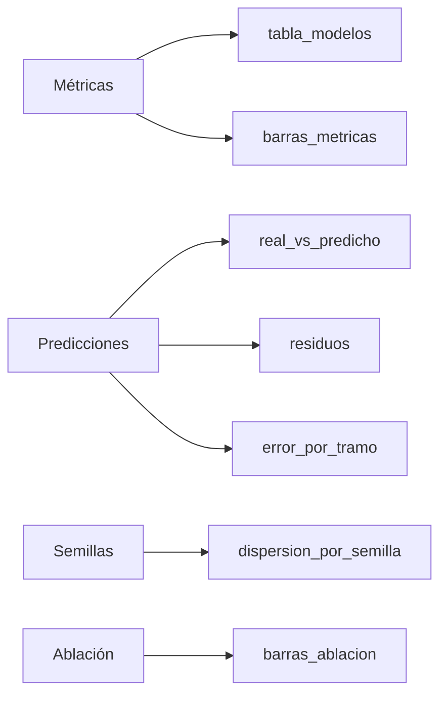

# API — Visualización

## Idea central

Las funciones de `src/ds02_rul/viz.py` que convierten predicciones en gráficos y tablas para el tribunal. 22 funciones; 7 estaban sin nodo previo.

> El gráfico es la evidencia; la función es el pincel.

## ¿Qué problema resuelve?

Sin visualización, las métricas son números abstractos. Estas funciones hacen que el tribunal vea (dónde acierta, dónde falla, cómo varía por semilla y por motor).

## Las piezas del modelo mental

### Tablas
- `nombre_corto(modelo)` → nombre abreviado.
- `tabla_modelos(summary, metricas=...)` → tabla comparativa de modelos (NB01 celda 19, NB02).
- `comparar_con_base(summary, base, metricas=...)` → delta vs baseline.
- `tabla_por_motor(y_real, y_pred, unidades)` → RMSE por motor (N18).
- `evaluar_clase(nombre, y_true, y_pred)` / `mostrar_clase(filas, orden_por="RMSE")` → clasificación de modelos.

### Gráficos
- `barras_metricas(summary, metricas, figsize)` → barras comparativas.
- `dispersion_por_semilla(seed_rows, metrica, figsize)` → dispersión por semilla (N16).
- `barras_ablacion(abl, metrica, figsize)` → barras de ablación (cyc_norm).
- `real_vs_predicho(y_real, y_pred, titulo, figsize)` → scatter real vs predicho.
- `residuos(y_real, y_pred, titulo, figsize)` → histograma de residuos (N4, N5, N6, N14, N18).
- `error_por_tramo(y_real, y_pred, tramos, figsize)` → MAE por tramo de RUL (N18).
- `curva_entrenamiento(historial, figsize)` → curva de entrenamiento (N18).
- `beta_por_fold(selection, figsize)` → beta por fold (N18).

### Internos
- `display(x)` (fallback fuera del notebook).

## El proceso completo, sin centrarnos en las cuentas

## Qué no debemos confundir

| Concepto | Qué significa | Qué no significa |
|---|---|---|
| tabla_modelos | Comparación de modelos | Una sola métrica |
| residuos | Distribución del error | Error por tramo |
| barras_ablacion | Efecto de quitar cyc_norm | Mejora del modelo |

## Conexión con los notebooks del repositorio

- `notebooks/ds02_ensemble/01_datos_y_bases.ipynb` celdas 17, 19, 22.
- `notebooks/ds02_ensemble/02_decision_ablacion_oof_ensamble.ipynb` celdas 12, 21, 23, 25.
- `notebooks/ds02_ensemble/03_evidencia_multisemilla_diagnostico.ipynb` celdas 13, 19, 21, 24, 27, 34, 37, 43, 46, 49.
- `src/ds02_rul/viz.py:19..321`.

## Resumen para recordar

> viz.py = pincel del tribunal: tablas comparativas, barras, scatter, residuos, tramos, curvas, beta por fold. 7 funciones sin nodo previo: nombre_corto, comparar_con_base, barras_metricas, barras_ablacion, real_vs_predicho, mostrar_clase, display.

## Autoevaluación

1. ¿Qué función muestra el error por tramo de RUL?
2. ¿Cuál compara modelos en una tabla?
3. ¿Qué gráfico muestra la dispersión por semilla?

## Estado

- [ ] En curso
