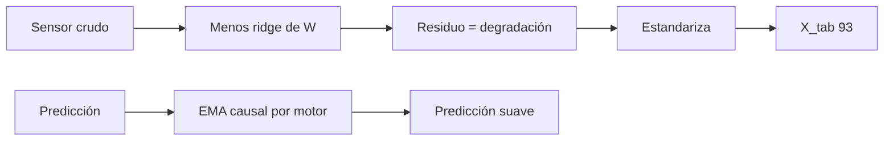

# API — Residualizador y suavizado

## Idea central

Quitar el régimen de vuelo de cada sensor (ridge) y suavizar la predicción con EMA causal por motor. `src/ds02_rul/residualizer.py` + `smoothing.py`.

> Sensor = degradación + punto de operación; el ridge quita el punto de operación. EMA quita el diente de sierra.

## ¿Qué problema resuelve?

Un árbol sin residualizar partiría por maniobras del piloto (altitud, Mach) en vez de por desgaste. Y una predicción sin suavizar saltaría de ciclo a ciclo, inutilizable para decidir.

## Las piezas del modelo mental

### `SensorResidualizer` (`residualizer.py:14`)
- **Clase:** residualizador contra el régimen.
- **`__init__(poly, ridges, res_scaler)`** (`residualizer.py:27`): recibe base polinómica, 14 ridges (Ridge α=1.0) y scaler de residuos.
- **`transform(W_scaled, Xs_raw) -> np.ndarray`** (`residualizer.py:32`): resta ridge(P) a cada sensor y estandariza. Devuelve residuos (N, 14).
- **Llamado desde:** `fit_preprocessing` (N4), `HybridStackingEnsemble._tabular` (N26).
- **Gotcha:** en inferencia, `_tabular` deshace el escalado global antes de residualizar.

### `causal_ema_by_unit(pred, units, cycles, span=5) -> np.ndarray` (`smoothing.py:14`)
- **Firma:** `causal_ema_by_unit(pred, units, cycles, span: int = 5) -> np.ndarray`.
- **Qué hace:** media móvil exponencial causal por motor (solo pasado). Quita diente de sierra sin fuga.
- **Retorno:** array suavizado (misma forma que pred).
- **Llamado desde:** NB02 celdas 21/25, NB03 celda 8, `HybridStackingEnsemble.predict`.
- **Gotcha:** agrupa por `units`; si no se pasan, mezcla motores (suavizado incorrecto).

## El proceso completo, sin centrarnos en las cuentas

## Qué no debemos confundir

| Concepto | Qué significa | Qué no significa |
|---|---|---|
| Residuo | Lo que el régimen no explica | Ruido sin información |
| Régimen | Condición de vuelo (W) | Desgaste |
| EMA causal | Solo usa el pasado | Suavizado centrado (fuga) |
| span=5 | Ventana de suavizado | Tamaño de ventana del modelo |

## Conexión con los notebooks del repositorio

- `notebooks/ds02_ensemble/01_datos_y_bases.ipynb` celda 11.
- `notebooks/ds02_ensemble/02_decision_ablacion_oof_ensamble.ipynb` celdas 21, 25.
- `notebooks/ds02_ensemble/03_evidencia_multisemilla_diagnostico.ipynb` celda 8.
- `src/ds02_rul/residualizer.py:14,27,32` + `smoothing.py:14`.

## Resumen para recordar

> SensorResidualizer: ridge(P) → residuo → estandarizar. causal_ema_by_unit: EMA por motor, solo pasado, span=5. Ambos son "descontar el viento".

## Autoevaluación

1. ¿Por qué un árbol sin residualizar partiría por maniobras?
2. ¿Qué es BASE_CYCLES=3 y por qué es causal?
3. ¿Por qué EMA causal y no centrada?

## Estado

- [ ] En curso
